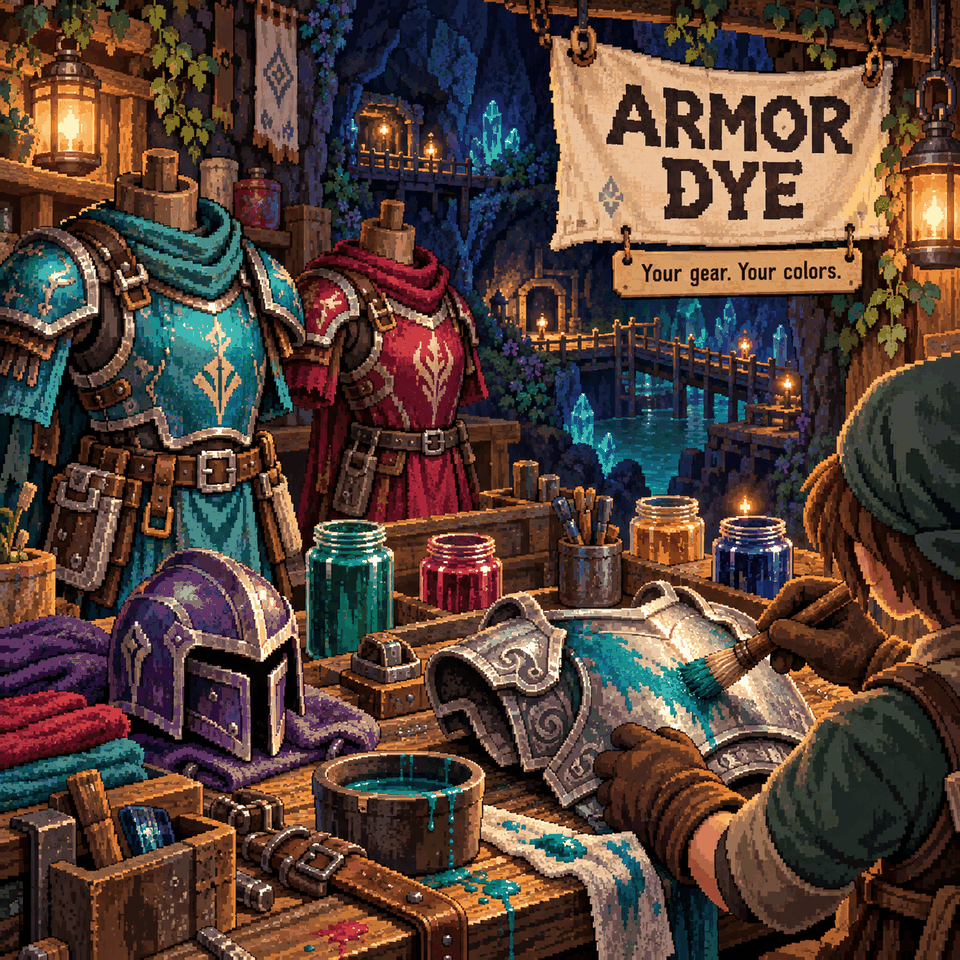

# Armor Dye

Make your gear your own: **recolor armor, weapons and tools**, with a separate dye for each item. The color stays with the item when you store, trade or upgrade it.

## Pick a color

1. Hover over an armor piece, weapon or tool in your inventory, hotbar, equipment or vanity slots.
2. Press **P** to open the palette. You can rebind this key under **Controls > Armor Dye**.
3. Click a color or hue shift. Choose **Remove dye** to restore the original look. Press P again or right-click to close.

The palette has 10 colors and 11 hue shifts. Dyes appear on armor, held items, item icons and supported projectiles. Other players with the mod can see them too. A dyed vanity item uses its own color; an undyed one uses the dye from the armor beneath it.

## Settings and requirements

Requires **CoreLib and Mod Options** on the host and every client.

In **Settings > Mod Options > Armor Dye**, you can separately show dyes on held weapons/tools, projectiles and item icons. All three start on. These switches only change your view.

Dyeable items include armor and single, non-stacking items with durability, such as weapons, tools and fishing rods. Off-hand items keep their normal appearance. Glowing parts are recolored too.

## Optional chat commands

For equipped items, use `/dye <helm|chest|pants|all|hand> <color>`.

Colors: `red`, `orange`, `gold`, `green`, `teal`, `blue`, `purple`, `pink`, `white`, `black`, a hex value such as `#33aaff`, `shift <degrees>`, or `off`. Use `/dye info` to inspect your dyes.

Implementation details are in [SPEC.md](SPEC.md).
