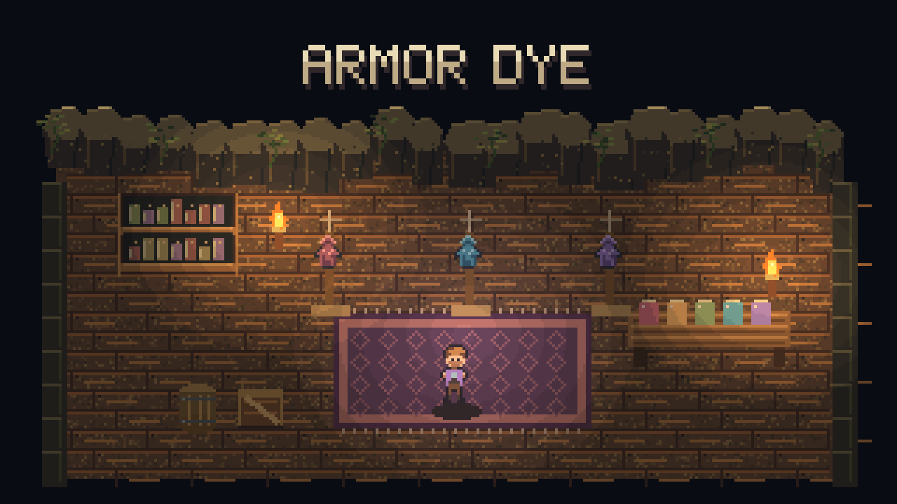

# Armor Dye

Armor Dye lets you pick a color for each piece of armor, weapon or tool. The dye stays with the item when you store, trade or upgrade it.

## Pick a color

1. Open your inventory and hover over an armor piece, weapon or tool in your inventory, hotbar, equipment or vanity slots.
2. Press **P** to open the palette. You can rebind this key under **Controls > Armor Dye**.
3. Click a color or hue shift. Choose **Remove dye** to restore the original look. Press P again, right-click or close your inventory to dismiss the palette.

The palette has 10 colors and 11 hue shifts. Dyes appear on armor, held items, item icons and supported projectiles. Other players with the mod can see them too. A dyed vanity item uses its own color; an undyed one uses the dye from the armor beneath it.

## Settings and requirements

For Core Keeper **1.3.0**. Install **CoreLib and Mod Options**, plus Armor Dye, on the host and every client.

In **Settings > Mod Options > Armor Dye**, you can separately show dyes on held weapons/tools, projectiles and item icons. All three start on. These switches only change your view.

Dyeable items include armor and single, non-stacking items with durability, such as weapons, tools and fishing rods. Off-hand items keep their normal appearance. Glowing parts are recolored too. The palette works on items in your own slots, so move an item out of a chest before dyeing it.

## Optional chat commands

For equipped items, use `/dye <helm|chest|pants|all|hand> <color>`. For example, `/dye helm blue` dyes your displayed helmet, and `/dye hand shift 120` changes the hue of the item in your hand. `all` applies to the three armor slots.

Colors: `red`, `orange`, `gold`, `green`, `teal`, `blue`, `purple`, `pink`, `white`, `black`, a hex value such as `#33aaff`, `shift <degrees>`, or `off`. Use `/dye info` to inspect your dyes.

Cover is an in-game screenshot of the dye palette; title banner and highlight added.
