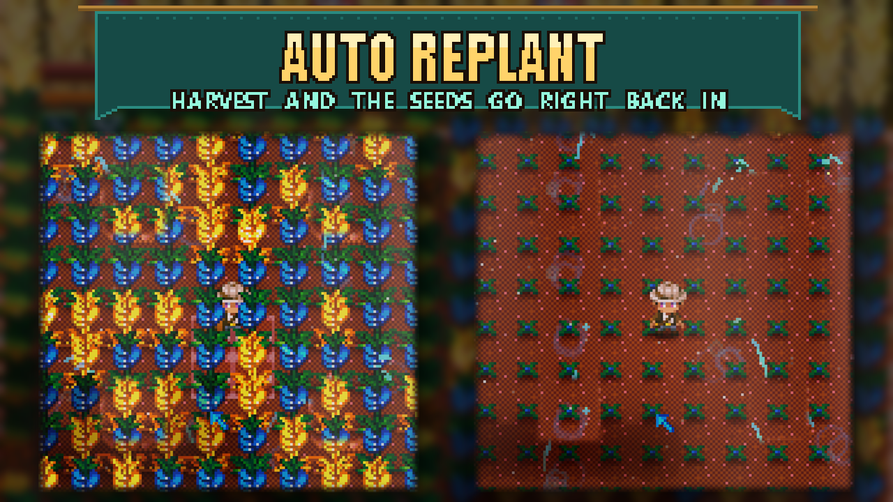

# Auto Replant

Auto Replant plants the same crop back after you harvest it, using one matching seed from near the harvested tile or from your inventory. Harvest as usual, including with an area harvest tool. If there's no seed available, the tile stays empty.

Replanting is on by default. Keep some spare seeds with you and plant on suitable ground; the mod won't take seeds from chests. Growth, watering and Gardening XP still follow the normal game rules.

## Settings

Open **Settings > Mod Options > Auto Replant** to change these while you play:

- **Auto replant** starts on. Turn it off when you'd rather leave the harvested tiles empty.
- **Use seeds from inventory** starts on. Turn it off if you only want to reuse dropped seeds or seeds you've just picked up from the harvest, without dipping into your existing supply.
- **Override golden chance** starts off, so you keep the usual 3% base chance plus your Gardening bonus.
- **Golden plant chance (%)** starts at 5% and can be set from 0–100%. It only takes effect when the override is on, replacing the 3% base chance. Your Gardening bonus still adds on top.

## Before you use it

You'll need **CoreLib** and **Mod Options**. In multiplayer, the host/server and everyone joining need all three mods. The server handles replanting, using the seeds of the player who harvested the crop.

Only ripe crops harvested by a player count. Automated harvesters and destroyed seedlings don't trigger replanting, and wild crops won't replant on ground where you couldn't plant their seeds yourself. Root-type plants only trigger a replant when destroyed. There can be a short delay while the old plant clears and a seed becomes available.

Auto Replant is also included in **Sid's Overhaul**. Use the standalone mod or the Overhaul version, rather than installing both.

Cover made from in-game screenshots of the same field before and after harvesting. HDR captures were tone-mapped, sprinklers were edited out, and a title banner was added.
