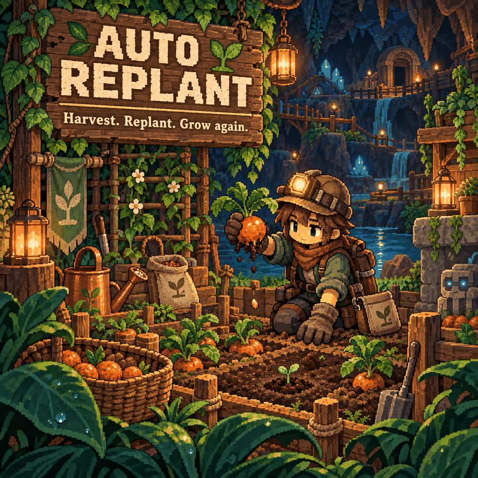

# Auto Replant

Harvest your crops and let the next planting take care of itself.

## How to use

Harvest a ripe crop on ground where its seed can be planted. Auto Replant uses one matching seed near the harvested tile, or a seed in your inventory, to plant the same crop again. **No seed means no replant.**

It works with player harvests, including area harvests. Growth, watering and Gardening XP follow the normal game rules. Automated harvesters and destroyed seedlings do not trigger it.

## Settings

Open **Settings > Mod Options > Auto Replant**. Changes apply while you play.

- **Auto replant: on.** Turn it off to plant everything yourself.
- **Use seeds from inventory: on.** If no dropped seed is available, use seeds you already carry. Turn it off to rely on dropped or newly collected seeds.
- **Override golden chance: off.** The normal 3% base chance plus your Gardening bonus is used by default.
- **Golden plant chance: 5%.** Only used when the override is on; choose 0–100%. Your Gardening bonus still adds on top.

## Requirements and limits

Requires **CoreLib** and **Mod Options** on the host/server and every client. Replanting runs on the server and uses the harvesting player's seeds.

Keep spare seeds with the harvesting player. Seeds in chests are not used. Wild crops on unsuitable ground are not replanted. Root-type plants trigger a replant only when destroyed. The mod waits briefly for the old plant to clear and a seed to become available.

Also included in **Sid's Overhaul**; use one version of this feature.
