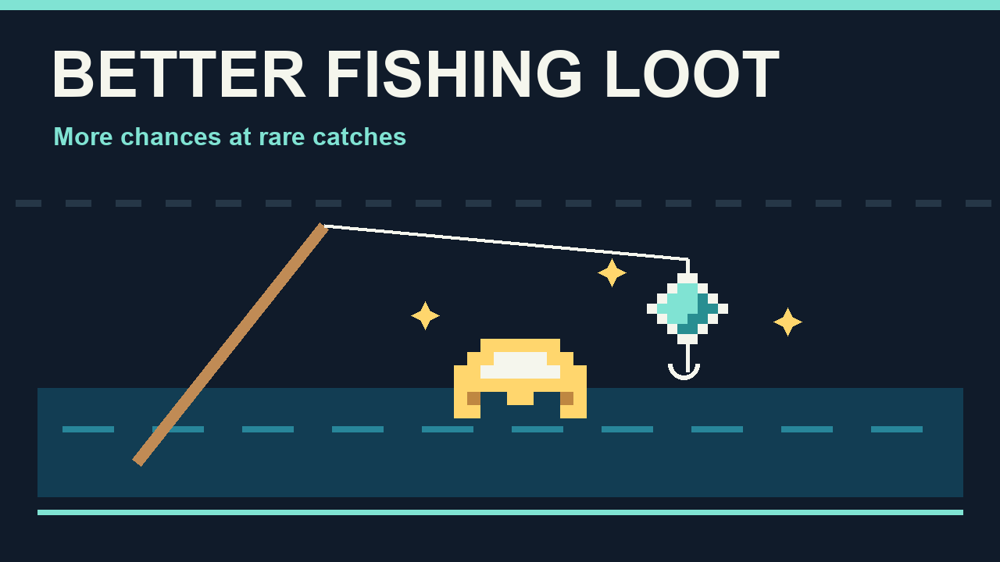

# Better Fishing Loot

Makes gear and rare items more likely when you fish up loot. Fish as usual; the mod changes what you find, with a setting for how generous you want it to be.

## Choosing the rate

Open **Settings > Mod Options > Better Fishing Loot** and pick **1x, 2x, 3x, 5x, 10x, or 25x**. It starts at **5x**. Choose 1x to go back to the usual odds. You can change this while playing.

The boost applies to armor, accessories, tools, pets, and items marked Rare or better. You still need to fish in the right water and biome to find them, and each loot catch still gives one item.

A 5x setting doesn't mean exactly five times the chance of a particular item. It gives those items more weight in the loot roll, so you're more likely to get them and less likely to get common loot. It doesn't give you extra copies of a catch.

**Core Iris** is the exception: in Molten Quarry water it is a flat **2.5%** of every loot catch at any setting (normally about 0.35%).

## What stays the same

You won't get more loot bites instead of fish bites, and the fish you can catch stay the same. Bait, legendary fish, and the fishing minigame work as usual. This only affects fishing loot, so it won't change chests or enemy drops.

## Installing

Requires **CoreLib** and **Mod Options**. In multiplayer, the host and everyone joining need all three installed. The host's setting decides the catch; use the same setting as the host so your game doesn't expect a different result.

Already using **Sid's Overhaul**? Better Fishing Loot is included, so you don't need a separate copy.
