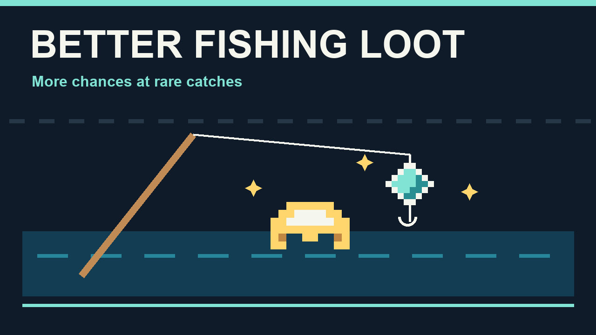

# Better Fishing Loot

A better chance of finding fishing gear and rare treasures, without changing the fishing minigame.

## How to use

Install the mod and fish as usual. Open **Settings > Mod Options > Better Fishing Loot** to choose a rare loot multiplier: **1x, 2x, 3x, 5x, 10x or 25x**. The default is **5x**; 1x restores the usual weights. Changes apply while you play.

## What changes

Armor, accessories, tools, pets and items marked Rare or better get a larger share of each fishing loot roll. The catch still depends on the water and biome, and each loot bite still gives one item.

The multiplier changes the item's **weight**, not its final percentage chance. As rare loot becomes more likely, common loot becomes less likely. It does not multiply the number of items you receive.

Fish tables, the chance of a fish bite versus a loot bite, bait, legendary-fish logic and the minigame keep their usual behavior. Chests and enemy drops are unaffected.

## Requirements

Requires **CoreLib** and **Mod Options**. Install on the host/server and every client. The host's setting decides the catch in multiplayer; matching settings avoids prediction differences.

Also included in **Sid's Overhaul**; use the standalone mod or the overhaul, rather than both.
