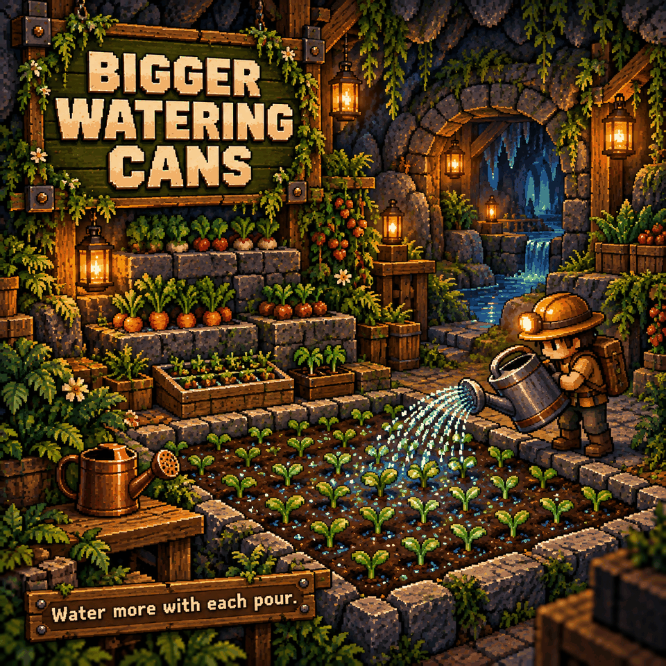

# Bigger Watering Cans

Water more of your garden with each pour. The basic Watering Can covers **2×2 tiles** and the Iron Watering Can covers **4×4 tiles**.

## How to use it

Equip your watering can and water as usual. The placement preview shows the area you will water. Both mouse and controller aiming use the enlarged area.

There are no settings. Water used per pour, refilling, cooldown and the chance to avoid using water keep their normal behavior.

## Requirements

No library dependencies. Install on the host/server and all clients, then restart Core Keeper.

## Limits

Only the basic and iron watering cans are changed. The splash animation remains a single effect at the pour position, even when several tiles are watered.

Where the game supports resizing the can with the rotate control, it can still cycle through smaller areas. The mod resets saved size choices to the full size once per world load.
