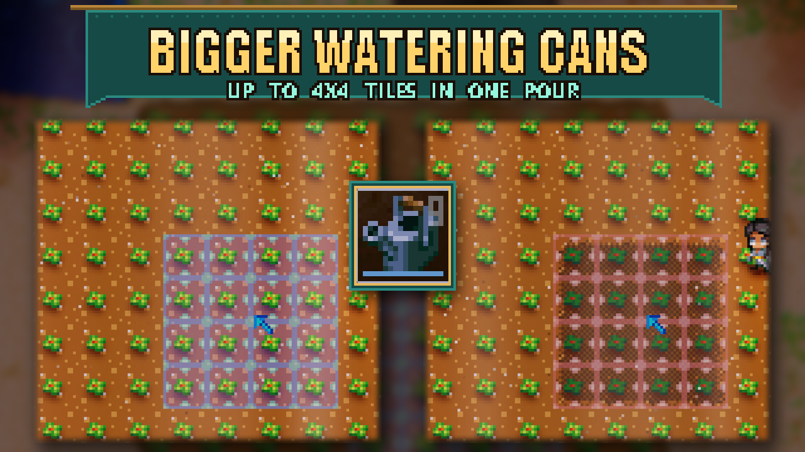

# Bigger Watering Cans

The basic Watering Can waters a **2x2 patch**, and the Iron Watering Can waters **4x4**. Equip one and water as usual; the preview shows which tiles you'll hit.

Mouse and controller aiming both work. Each pour uses the normal amount of water, with the usual cooldown, refill behavior, and chance to save water. There are no settings to change.

## A couple of things to know

Only the basic and iron cans get bigger. You'll still see one splash where you pour, even though it waters the whole patch.

If your can supports the game's rotate control for changing its size, you can still cycle down to a smaller area. It starts at full size again whenever you load a world.

## Installing

You don't need any library mods. In multiplayer, install Bigger Watering Cans on the host and everyone joining, then restart the game.
