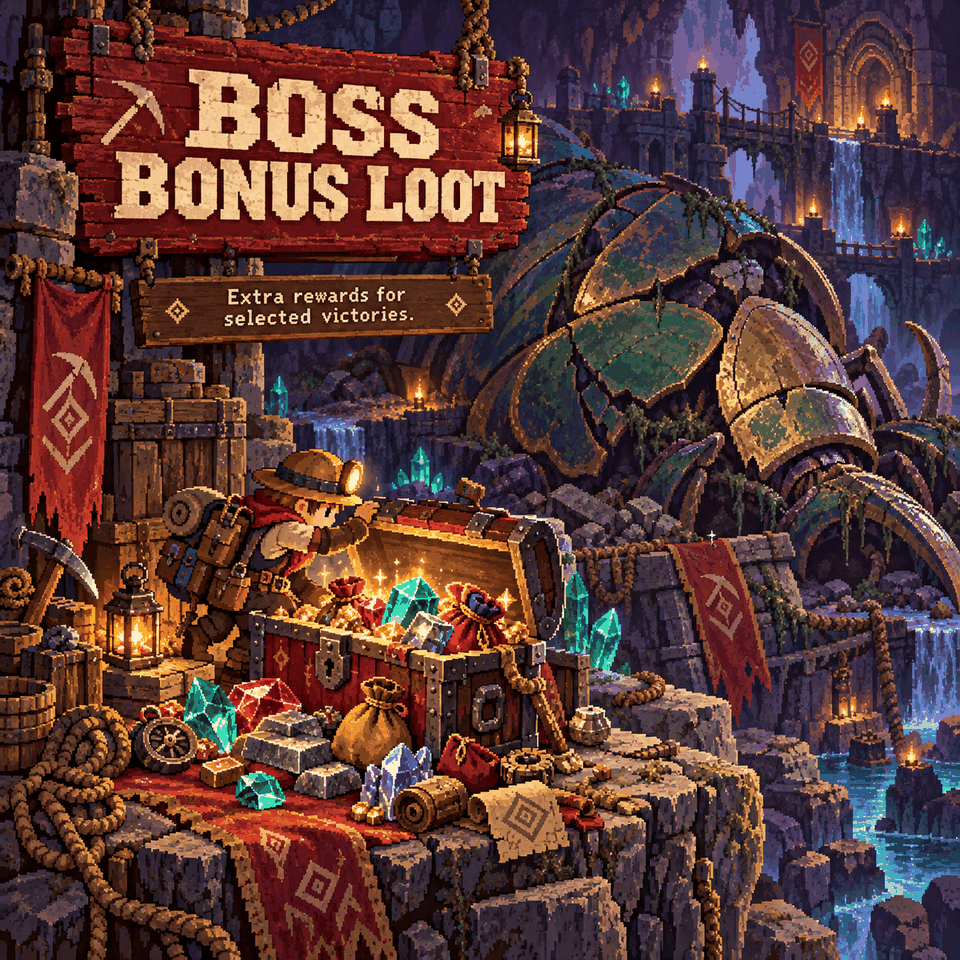

# Boss Bonus Loot

Make selected boss victories more rewarding with extra materials, gemstones and chances at useful gear.

## Bonus rewards

Boss bonuses drop at the defeated boss in addition to its normal loot chest. Each chance below is rolled separately.

| Enemy | Extra rewards |
|---|---|
| Ghorm | 80 Larva Meat and 80 Golden Larva Meat, guaranteed |
| Azeos | 1 Jungle Emerald, guaranteed. Chipped Blade and Clear Gemstone: 25% each. Large Seed and Crop Pouch and Large Critter Pouch: 40% each. |
| Omoroth | 1 Ocean Sapphire, guaranteed. Large Fish Pouch and Large Potion Pouch: 40% each. |
| Ra-Akar | 1 Desert Ruby, guaranteed. Large Valuable Pouch and Large Ore and Block Pouch: 40% each. |
| The three biome Hydras | Double the amounts of Jungle Emeralds, Ocean Sapphires and Desert Rubies in their loot tables |

## Regular enemy changes

Mimites and Orbital Turrets each roll a **10% chance per gemstone** for a Jungle Emerald, Ocean Sapphire and Desert Ruby. Void Larvae have a **20% chance** to drop an Oblivion Fragment. These rolls replace the corresponding ordinary random loot-table entries.

## Larva Meat

Every monster that drops Larva Meat drops **3x as much** by default. Change it under **Settings > Mod Options > Boss Bonus Loot > Larva Meat drops** (1x = vanilla, up to 10x); it applies right away. Ghorm's fixed bonus above is not scaled.

## How to use and requirements

Requires **CoreLib** and **Mod Options**. Install on the host/server and every client; the host decides the rolls.

Only the listed enemies and loot entries change. A chance-based reward is not guaranteed, and this does not multiply all boss loot. Also included in **Sid's Overhaul**; use one version of this feature.
