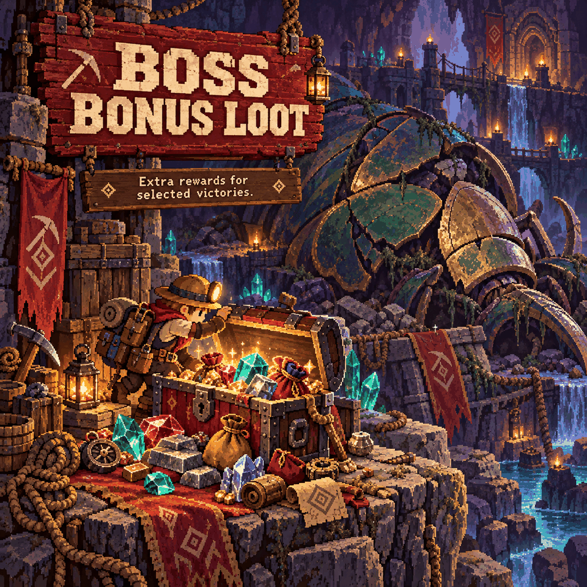

# Boss Bonus Loot

Boss Bonus Loot adds extra drops to a handful of bosses. Ghorm drops stacks of meat, the biome Titans drop a guaranteed gemstone, and some bosses get a chance to drop pouches, weapon parts or permanent-buff food.

## Bonus rewards

The extra items drop where the boss dies, alongside its normal loot chest. Each item gets its own roll, so you can get more than one bonus from a kill.

| Enemy | Extra rewards |
|---|---|
| Ghorm | 80 Larva Meat and 80 Golden Larva Meat, guaranteed. Amber Larva: 10% (replaces its usual roll in Ghorm's loot). |
| Glurch | Adventurer's Hat: 30% (replaces its usual roll in Glurch's loot). Anniversary Cake: 15%. |
| Igneous | Core Iris: 20% (replaces its usual roll in Igneous's loot). Splendid Amalgam: 15%. |
| Morpha | Topaz Ring: 10% (replaces its usual roll in Morpha's loot). |
| Crydra the Ice Titan | Golden Chocolate: 15% |
| Druidra the Wild Titan | Paradise Fruit Basket: 15% |
| Azeos | 1 Jungle Emerald, guaranteed. Chipped Blade and Clear Gemstone: 25% each. Large Seed and Crop Pouch: 40%. Large Critter Pouch: 40%. |
| Omoroth | 1 Ocean Sapphire, guaranteed. Large Fish Pouch and Large Potion Pouch: 40% each. Rusted Necklace: 20% (replaces its usual roll in Omoroth's loot). |
| Ra-Akar | 1 Desert Ruby, guaranteed. Large Valuable Pouch and Large Ore and Block Pouch: 40% each. |
| The three biome Hydras | Double the amounts of Jungle Emeralds, Ocean Sapphires and Desert Rubies in their normal loot |

## Regular enemy changes

Mimites and Orbital Turrets each roll a **10% chance per gemstone** for a Jungle Emerald, Ocean Sapphire and Desert Ruby. Void Larvae have a **20% chance** to drop an Oblivion Fragment. Bubble Crabs have a **3% chance** to drop a Topaz Ring. These chances replace the usual random rolls for those items; they are not extra rolls on top of them.

Infected Cavelings drop the Tome of the Dead **5%** of the time (vanilla 0.43%). This raises the tome's share of their normal loot roll; the other drops keep their relative odds, only the empty roll gets smaller.

## Larva Meat

Monsters that normally drop Larva Meat drop **3x as much** by default. You can change this from 1x (vanilla) to 10x under **Settings > Mod Options > Boss Bonus Loot > Larva Meat drops**. Changes apply right away. Ghorm's fixed bonus of 80 Larva Meat and 80 Golden Larva Meat stays the same whatever you choose.

## Installation and multiplayer

For **Core Keeper 1.3.0**. Requires **CoreLib** and **Mod Options**. Install on the host/server and every client; the host decides the rolls.

Only the enemies and items listed here change. The percentage drops can still take several kills to get; this does not multiply all boss loot.

This is also included in **Sid's Overhaul**. Use either the standalone mod or the Overhaul copy, so you only have this feature installed once.
