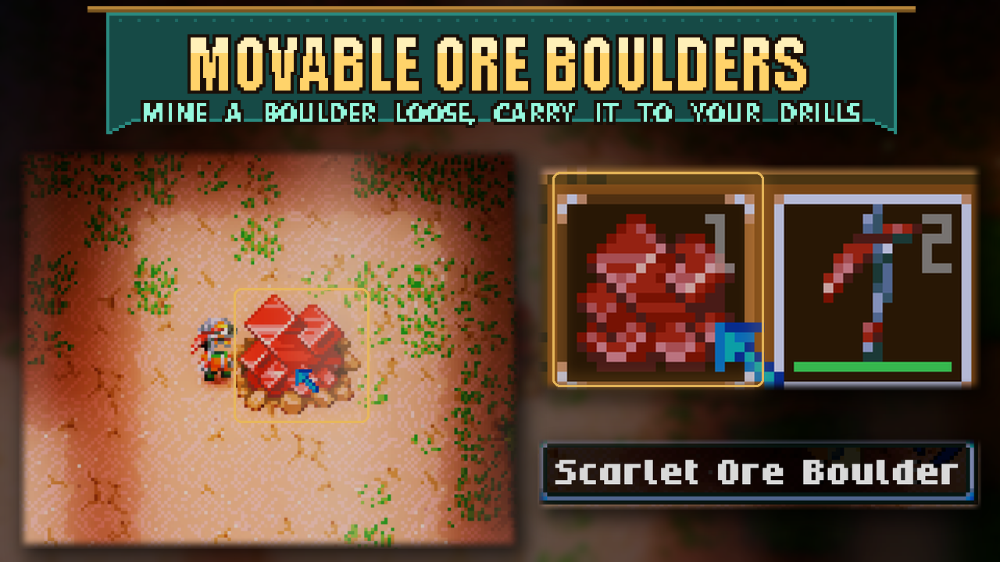

# Movable Ore Boulders

Mine an ore boulder loose, carry it home, and place it beside your drills. This works with every ore boulder type, including pandorium and relucite.

Your pickaxe needs enough mining damage to break a **Maze Block**, the walls used in ancient mazes. Keep hitting the boulder until you have done about three Maze Blocks' worth of mining. It then drops as an item and flies toward you. Place it as you would any other object.

Weaker pickaxes cannot loosen boulders. There is no mining progress bar: you see the hits, then the boulder comes loose. Mining never gives ore; drills still extract ore as usual. Explosions and weapons do not move boulders or make them drop ore.

## Moving a drilled boulder

By default, you can only pick up untouched boulders. Once drills have worn a boulder down, it stays where it is. With Infinite Ore Boulders, drilled boulders can still be moved.

To move worn-down boulders too, open **Settings > Mod Options > Movable Ore Boulders** and turn on **Move drilled boulders (refills them)**. This is **off by default**. A moved boulder is full again when placed, so enabling it lets you replenish ore by moving the boulder.

## Requirements and multiplayer

Requires **CoreLib** and **Mod Options**. In multiplayer, install the mod on the host and every client. The host decides when a boulder comes loose and whether drilled boulders can be moved.

The mod changes how ore boulders take damage, so it may conflict with mods that also change their mining, damage, or destruction.

Cover is made from in-game screenshots of a Scarlet Ore Boulder placed in the desert and the boulder item in the hotbar (HDR captures tone-mapped); title banner and highlights added.
