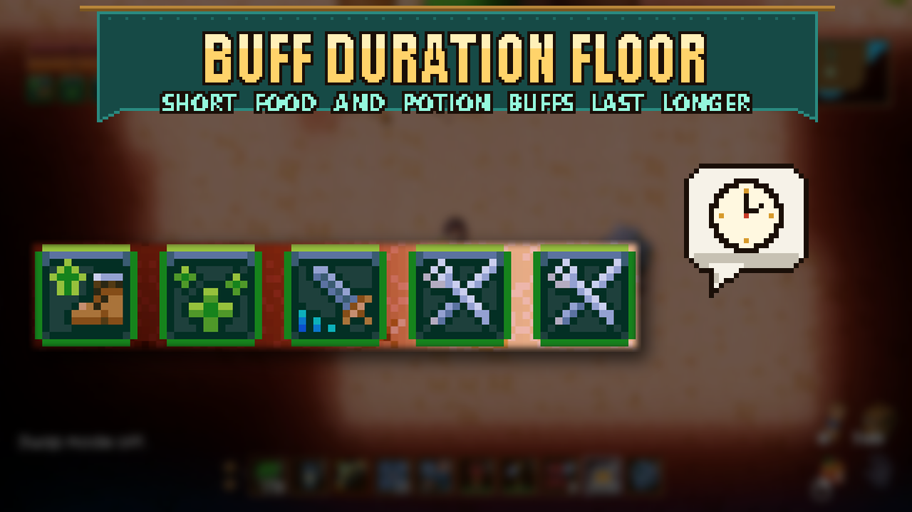

# Longer Buffs

Makes short food and potion buffs last at least **three minutes** by default. Anything that already lasts longer keeps its usual duration. You can change the minimum if you'd rather have more or less time between eating and drinking.

This used to be called **Buff Duration Floor**. Your saved settings carry over.

## Settings

Open **Settings > Mod Options > Longer Buffs**. There are two options:

- **Minimum buff duration:** three minutes by default. Covers timed buffs from food and potions, like extra movement speed or damage.
- **Minimum healing duration:** off by default. Covers healing over time and mana regeneration from consumables. Making these last longer can give you a lot more healing, so they're separate.

For either setting, choose Off, 30 seconds, 45 seconds, 1 minute, 1:30, 2 minutes, 3 minutes, 5 minutes, or 10 minutes. **Off** puts that group back to its normal durations.

Changes save automatically and apply to the next food or potion you use. Anything already active keeps its current timer. Item tooltips show the new durations.

## What it doesn't extend

Debuffs, instant healing, permanent bonuses, equipment effects, and most talent effects stay as they are. The mod only changes buffs that come from the food or potion itself.

For example, the fishing talent that gives **+15% damage against bosses for one minute** still lasts one minute. Talent bonuses that add melee attack speed after eating cooked food or healing over time after drinking a potion also keep their usual timers.

## Installing

You'll need **CoreLib** and **Mod Options**. In multiplayer, the host and everyone joining need all three mods installed. Restart Core Keeper after installing.

The host's settings decide how long buffs actually last. Use the same settings as the host so your game doesn't briefly show a different duration.
