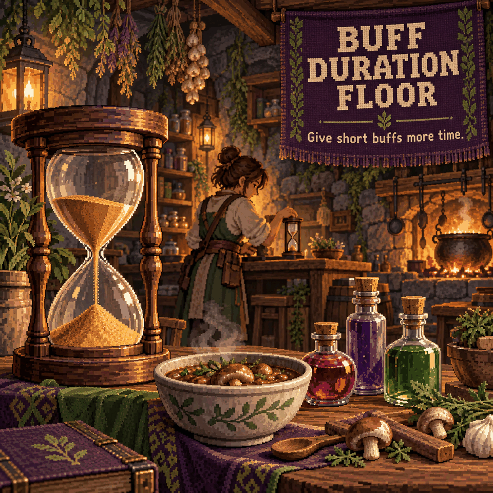

# Buff Duration Floor

Keep short food and potion buffs active longer. Choose a minimum duration; effects already lasting longer keep their normal duration.

## Settings

Open **Settings > Mod Options > Buff Duration Floor**.

| Setting | Default | What it changes |
|---|---|---|
| Minimum buff duration | **3:00** | Positive timed food and potion effects, such as movement speed or damage |
| Minimum healing duration | **Off** | Consumable healing-over-time and mana regeneration |

Both settings offer Off, 30 s, 45 s, 1:00, 1:30, 2:00, 3:00, 5:00 and 10:00. **Off** restores the normal duration for that group. Healing is separate because extending regeneration can substantially increase total healing.

Changes affect the next food or potion you consume. Buffs already active keep their existing timers. Settings save automatically, and item tooltips reflect the adjusted consumable durations.

## Requirements and multiplayer

Requires **CoreLib** and **Mod Options**. Install on the host/server and every client, then restart Core Keeper. The host/server determines actual durations; matching settings avoids temporary client differences.

## What stays unchanged

Debuffs, instant healing, permanent bonuses, equipment effects and most talent effects are not extended. This mod changes effects stored on the consumable itself.

In particular, the fishing talent's **+15% damage against bosses for 1 minute** stays at one minute. Talent-added melee attack speed from cooked food and potion healing-over-time also keep their hard-coded durations.
