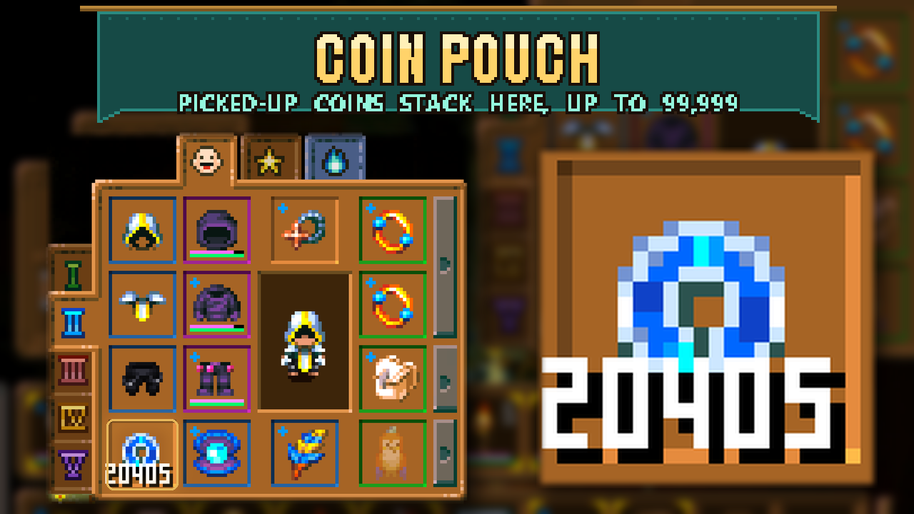

# Coin Pouch

A coin slot in the equipment window, in the empty corner under the vanity pants. Ancient Coins you pick up go straight into it, so they stop taking up an inventory slot. It holds up to **99,999** coins, well past the normal 9,999 stack.

- **Automatic:** picked-up coins go into the slot. Coins that end up in your inventory anyway (selling to a merchant, taking them from a chest, dragging them out) are moved back into it right away.
- **Shared by every loadout:** switching equipment tabs keeps the same coins.
- **Merchants:** buying works the same as with coins in your inventory. Prices show as affordable and payment comes out of the slot.
- **Only coins fit:** anything else shakes the slot like a wrong armor piece.
- **Kept on death:** coins in the slot are not dropped when you die (the game only drops your main inventory).
- **Not quick-stacked:** quick stack to nearby chests leaves the slot alone. You can still drag coins into a chest yourself; they come back if they land in your inventory.

No settings and no library dependencies. Install on both the host and clients in multiplayer.

## Install

Subscribe to the Workshop item, or extract the manual archive into `CoreKeeper_Data/StreamingAssets/Mods/CoinPouch` so `ModManifest.json` sits directly inside that folder. Restart Core Keeper. Existing characters get the slot when they join a world, and coins already in the inventory move into it. Do not run the standalone version alongside an Overhaul version that already includes Coin Pouch.

**Before uninstalling**, drag your coins out of the slot into the inventory or a chest (with more than 9,999 coins, split them across several stacks). Without the mod the slot no longer exists and coins left in it are lost.

## Limits

- If you add or remove other mods that add player inventory slots and then rejoin the world you played last, the coins may not follow the slot to its new position. Joining any other world moves them correctly.
- The slot is a full Ancient Coin stack once it reaches 99,999; further coins stay in the inventory.

## Development

How it is put together: the player prefab gets one extra slot at the end of its ContainedObjectsBuffer, a 1x1 inventory range over it, and a slot requirement that only accepts Ancient Coins. Because it is a real inventory range, the game's own code prefers it for pickups, counts it for merchant prices and takes payment from it. `CoinPouchSystem` (server, every 6 ticks, read-only until there is work) adds the slot to older characters, keeps it locked so quick stack skips it, and moves coins from the inventory into it past the hard-coded 9,999 stack limit. `CoinSlotUI` clones the armor pants slot into the character window; Harmony patches point it at the coin range and add its coins to the merchant affordability check.
