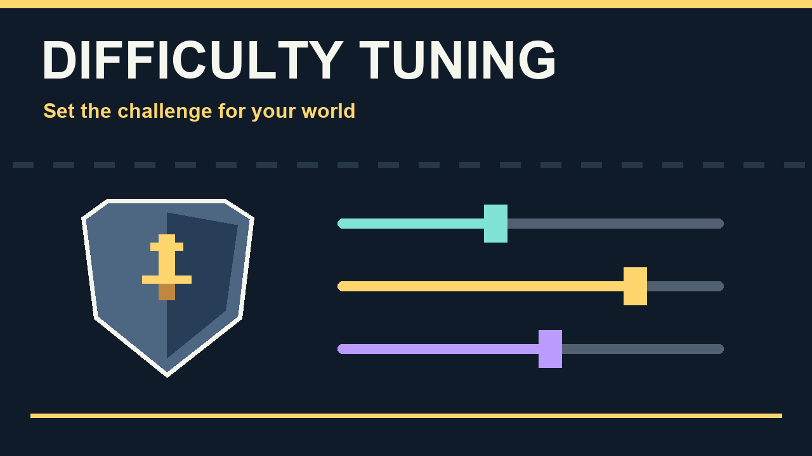

# Difficulty Tuning

Difficulty Tuning lets you change how hard enemies hit, how much health they have, and how quickly regular enemies move and attack. Hard and normal worlds have separate settings, so changing one leaves the other alone.

This mod was previously called **Hard Mode Tuning**.

With the defaults, regular enemies in hard worlds deal **1.5x normal damage** instead of the usual 2x. They still have the usual hard-mode 1.5x health, and bosses keep their vanilla hard-mode stats. Normal worlds are unchanged by default.

Open **Settings > Mod Options** and choose **Difficulty Tuning (Hard)** or **Difficulty Tuning (Normal)**. After changing anything, **reload the world** for it to take effect.

## Settings

Regular enemy damage and health are measured against normal mode. Boss damage and health are measured against the world's own difficulty: 1x means vanilla hard-mode bosses in a hard world, or vanilla normal-mode bosses in a normal world.

- **Regular enemy damage and health:** each defaults to 1.5x in hard worlds and 1x in normal worlds. Choose from 1x–2x in hard worlds or 0.5x–2x in normal worlds, in 0.25 steps.
- **Regular enemy movement, projectile speed and attack recharge:** three separate settings, all defaulting to 1x. Each offers 0.9x–1.5x in 0.05 steps, then 1.75x, 2x, 2.5x and 3x.
- **Boss damage and health:** separate settings, both defaulting to 1x. Each offers 0.9x–1.5x in 0.05 steps.

Movement boosts taper off for enemies that are already fast. At a 2x setting, slower enemies get the full boost, while the fastest get 1.1x. Settings below 1x slow enemies directly.

Recharge controls how soon an enemy can attack again: 1.25x means attacks recover faster, with 80% of the usual cooldown. Boss speed and attack patterns stay unchanged, as does loot.

## Installation and multiplayer

The host/server and every client need **Difficulty Tuning**, **CoreLib** and **Mod Options**. The host's settings determine enemy stats, and changes apply the next time the world loads.

Difficulty Tuning is also included in **Sid's Overhaul**. Use the standalone mod or the bundled version so the feature only runs once.

Cover artwork generated with AI; not an in-game screenshot.
