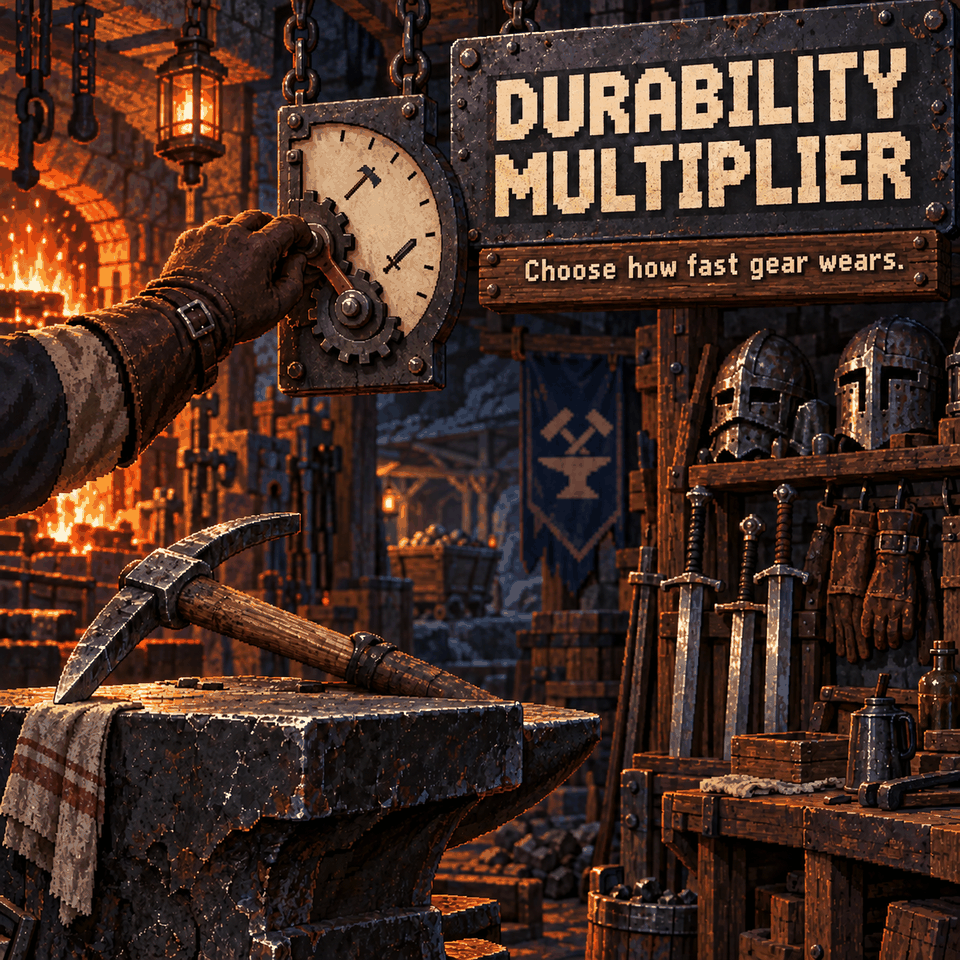

# Durability Multiplier

Your tools, weapons, and armor wear out half as fast by default, so you can go longer between repairs. You can lower the wear even further or turn it off completely.

## Changing the rate

Open **Settings > Mod Options > Durability Multiplier** and change **Durability loss rate**:

- **0.5x** is the default: your equipment lasts about twice as long over many uses.
- **0x** stops durability loss entirely.
- **0.1x, 0.25x, and 0.75x** give you other rates to choose from.
- **1x** puts wear back to the normal game rate.

Changes take effect straight away and save automatically. You'll still need to repair any damage your gear already has.

Durability goes down in whole points, so a lower rate means some uses won't wear your gear down at all. An individual hit can still cost the usual amount, including when you're wearing armor. The rate is an average over time.

## Installing

Requires **CoreLib** and **Mod Options**. Install the mod and its requirements, then restart Core Keeper.

In multiplayer, the host and everyone joining need it installed. The host's rate is the one that counts. Set yours to match so the durability you see doesn't briefly disagree with the host.

Avoid running another mod that changes durability at the same time.
