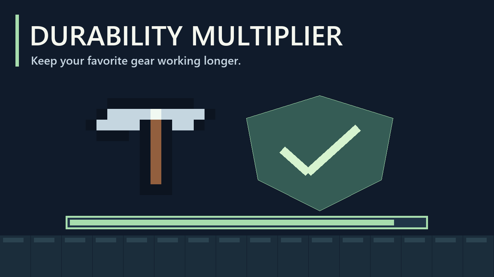

# Durability Multiplier

Make tools, weapons and armor last longer between repairs. Choose reduced wear or turn durability loss off entirely.

## Settings

Open **Settings > Mod Options > Durability Multiplier** and adjust **Durability loss rate**.

- **0.5x (default):** roughly twice the equipment life over many uses.
- **0x:** no durability loss.
- **0.1x, 0.25x, 0.75x:** other reduced-wear options.
- **1x:** the normal game rate.

Changes apply immediately and save automatically. Repairs work as usual; this mod does not repair existing damage.

## Requirements and multiplayer

Requires **CoreLib** and **Mod Options**. Install on the host/server and all clients, then restart Core Keeper. In multiplayer, the host/server's rate determines the result. Matching client settings avoids brief prediction differences.

## Limits

Durability uses whole points. Reduced wear is applied through chance, so individual swings or hits can still cost the normal amount; the selected rate describes the average over time. Armor wear from a hit is either skipped or applied in full.

Disable **Disable Durability** if installed. Use this mod's 0x setting for that behavior instead.
