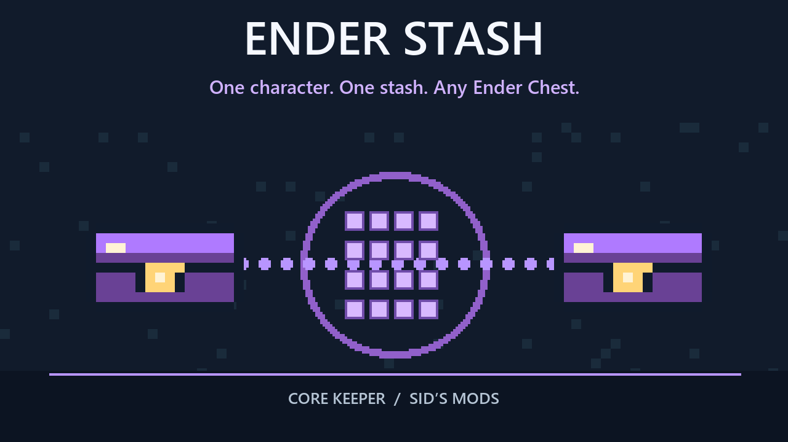

# Ender Stash

Keep a **personal 40-slot stash** you can open from any Ender Chest, across worlds. Your character owns the contents, so each player sees their own items and the stash stays safe when you die.

## Getting started

1. Buy an **Ender Chest from the Fishing Merchant for 9,999 ancient coins**. He stocks one per restock, at the top of his list.
2. Place it and open it like a normal chest.
3. Place more Ender Chests wherever you need access. They all open that character's same stash.

Shift-click moves items between your inventory and stash. Sort sorts the stash. Quick stack adds matching items from your inventory, excluding your hotbar. Walking away or breaking the chest closes the window; breaking the chest leaves your stored items safe.

## Requirements and limits

No settings or library dependencies. Install on the host and every client in multiplayer. Ordinary chests keep their normal behavior.

**Empty your stash before removing the mod.** Removing it removes placed Ender Chests and can lose the items stored in its extra slots. Keep a save backup before changing mods that add inventory slots.

Upgrading from 1.x? Your items are kept, but the old purple button is gone. Buy an Ender Chest to reach them.

## How it works (for modders)

- **The object** is a real modded object (`ObjectAuthoring.objectName = "EnderStash_EnderChest"`,
  ObjectID assigned by the game above 32767; saves store it by name). Its prefabs, sprites and name
  text live in `Bundles/EnderStash_*.assetbundle`, built with the official Core Keeper Mod SDK by
  `Unity/build_bundle.py` (see below). The logic prefab mirrors the vanilla `ChestEntity` minus the
  inventory; the graphics prefab uses the vanilla `Chest` component, so the bundle has no script
  references of its own and works inside Sid's Overhaul too. Price: sellValue 2000 x 5 x 0.9999 = 9999.
- `StashLayout`: 40 slots appended to the player prefab's `ContainedObjectsBuffer`
  (`API.Authoring.OnObjectTypeAdded`, subscribed on the first `Update` so they always come after
  Loadout Fallback / Five Loadouts / vanity slots). The character save stores the whole buffer.
  Death drops only slots 10..maxSize of `InventoryBuffer[0]`, so the stash is safe.
- `StashGrowSystem` (server) grows older characters' buffers to include the stash and runs `StashGuard`.
- `StashGuard` keeps the stash in place when a mod that also appends player slots (Pouch Lite, Five
  Loadouts...) is installed or removed, which shifts where the stash starts. The slot after the stash is a
  marker (`objectID` None, `variationUpdateCount` = 0x45535448, `variation` = stash start) that the
  character save keeps. On join, a postfix on `SaveManager.GetCharacterDataFromSerialized` moves the stash
  inside the decoded character (before `StartGameRPCSystem` copies it, which would cut off slots past the
  new length). Rejoining the world you were last in uses the world save's player instead (the world save
  drops the marker but keeps the old slot count), so the guard remembers the stash items it saw and moves
  them on the live player if they are still at the old position. Tested both directions (+10 / -10 slots,
  both join paths): items, aux data and other slots unchanged.
- Player memory: the stash adds no component or buffer type to the player (it only appends elements to
  `ContainedObjectsBuffer`, `InternalBufferCapacity(1)`, so they live on the heap), so it does not count
  toward the shared 16 KB chunk limit for the player archetype.
- `EnderChestMerchantSystem` (server) puts the Ender Chest at index 0 of the Fishing Merchant's
  `MerchantItemInfoBuffer` (prefab and merchants already in saves; forces one restock when added).
- Patches: `Chest.Use` (an Ender Chest opens the chest window on
  `new InventoryHandler(player, world, start, 10, 40)`), `Chest.OnPlayerLeftChest` (closes it),
  `InventoryHandler.Sort` (sorts the stash via swaps), `Create.QuickStack` (quick stack into the
  stash), `InventoryUI.UpdateContainerSize` (force a size refresh).

## Rebuilding the asset bundle

Needs Unity 6000.0.59f2 with Linux Build Support (Mono), and https://github.com/Pugstorm/CoreKeeperModSDK
cloned to `C:\Users\Sid\CoreKeeperModSDK`. Then `python Unity/build_bundle.py` (add `--art` to
regenerate the art from the vanilla black chest). Art: `Unity/Art`, made by `Unity/make_art.py`.

Removing the mod drops the stash slots from future saves (items in it are lost) and removes placed
Ender Chests.
