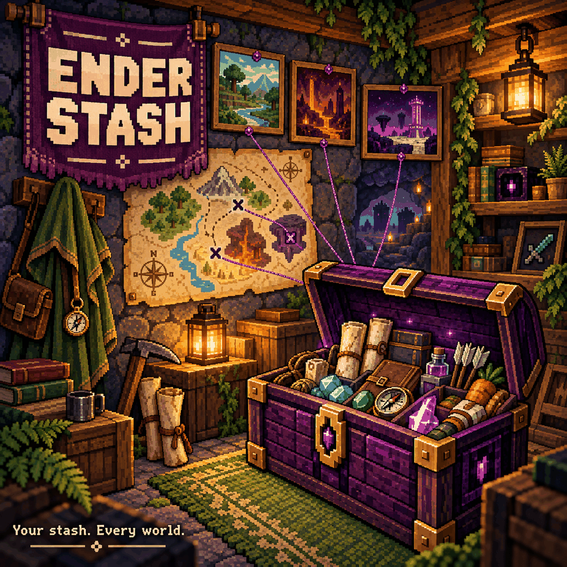

# Ender Stash

Ender Chests all open the same **40-slot stash** for your character, even in different worlds. In multiplayer, everyone sees their own items when they open one. Your stash stays safe when you die.

## Getting a chest

Buy an **Ender Chest from the Fishing Merchant for 9,999 Ancient Coins**. It's at the top of his shop, with one available each restock.

Place it and open it like a normal chest. You can put more Ender Chests around your bases or in other worlds to reach the same items from each one.

Shift-click moves items in or out. Sort tidies the stash, and quick-stack puts matching items away without touching your hotbar. Walking away or breaking the chest closes the window. Breaking a chest won't spill or delete what's in your stash.

## Installing or updating

There are no settings and you don't need any libraries. For multiplayer, the host and everyone joining need the mod. Your ordinary chests work as usual.

If you're updating from 1.x, your items are still there. The old purple button is gone, so buy an Ender Chest to open the stash.

**Empty your stash before removing the mod.** Uninstalling removes placed Ender Chests, and items left in the stash can be lost. Back up your save before adding or removing mods that change inventory slots.

For the code and asset-bundle setup, see the [developer notes](https://github.com/Sthakur27/corekeeper-mods/blob/main/EnderStash/DEVELOPER.md).
