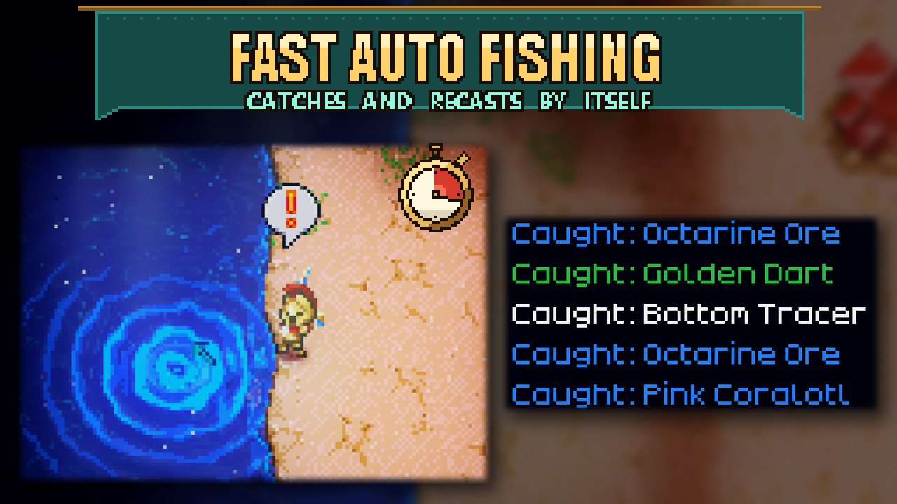

# Fast Auto Fishing

Cast your line and let it keep catching fish for you. Fast Auto Fishing skips the fishing minigame and cuts down the wait between catches. Right-click or start walking when you're done.

## Using it

Open your inventory and turn on auto-fishing, then equip a rod and cast. It's on by default with a fresh config. Once you've cast, it'll catch and recast until you stop it. Automatic input pauses while you have your inventory or a menu open.

To stop, right-click once or start walking. It'll reel in the current line, keeping the fish if one's biting, and won't cast again.

The inventory toggle turns the automatic fishing on and off. **The shorter waits and animations stay active while the mod is installed**, even with the toggle off. There's no speed setting.

## How much faster?

Bite waits are capped at **0.05 seconds**, the nibble window at **0.6 seconds**, and casting and reeling animations at **0.25 seconds**.

Each catch still uses the usual loot, bait, XP, and shoal rules. You just get through more catches in the same time.

Octopus boss bites are different: you'll need to respond to those yourself, and their bite wait stays the same. Casting and reeling are still faster.

## Installing

You don't need any library mods. In multiplayer, the host and everyone joining need Fast Auto Fishing. Restart Core Keeper after installing it. Don't run the original version alongside this fork; the game treats them as the same mod.

## Credits

This is a fork of **mikufish** by **Jiamu Sun**, with faster fishing timers added by **Sid**. It's licensed under **GPL-3.0-or-later**, and the source is included.

See the [developer note](https://github.com/Sthakur27/corekeeper-mods/blob/main/FastAutoFishing/DEVELOPER.md) if you're working with the mod's assets.
