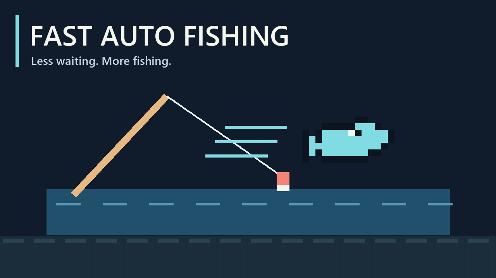

# Fast Auto Fishing

Spend less time waiting for bites. Automatically respond to fish nibbles and shorten the delays in the fishing loop.

## How to use it

Open your inventory and use the auto-fishing toggle, then equip a fishing rod and cast. Automatic nibble responses start enabled on a fresh configuration. The helper turns off the fishing minigame while enabled and pauses its automatic input while menus or inventory are open.

With auto-fishing on, it keeps catching and recasting by itself. To stop, right-click once or start walking. The mod reels in the current line (landing the fish if one is biting) and doesn't cast again.

The inventory toggle controls automatic nibble responses. The faster timing stays active while the mod is installed; there is no speed setting.

## What changes

- Bite waits are capped at **0.05 seconds**.
- The nibble window is capped at **0.6 seconds**.
- Cast, throw and reel-in animations are capped at **0.25 seconds**.

Loot tables, bait use, XP per catch and shoal rules keep their normal behavior. Shorter waits let you make more catches over time.

## Requirements and limits

No library dependencies. Install on the host/server and all clients, then restart Core Keeper. Disable the original **Autofish / mikufish** when using this fork; both use the same mod identity.

Octopus boss bites are not answered automatically and their bite timer is not shortened. The shorter cast, throw and reel-in timers still apply.

## Credit and license

Fork of **mikufish** by **Jiamu Sun**, with faster fishing timers added by **Sid**. Licensed **GPL-3.0-or-later**; source ships with the mod.

The internal manifest name remains `mikufish` because its existing toggle-button asset references that assembly name.
