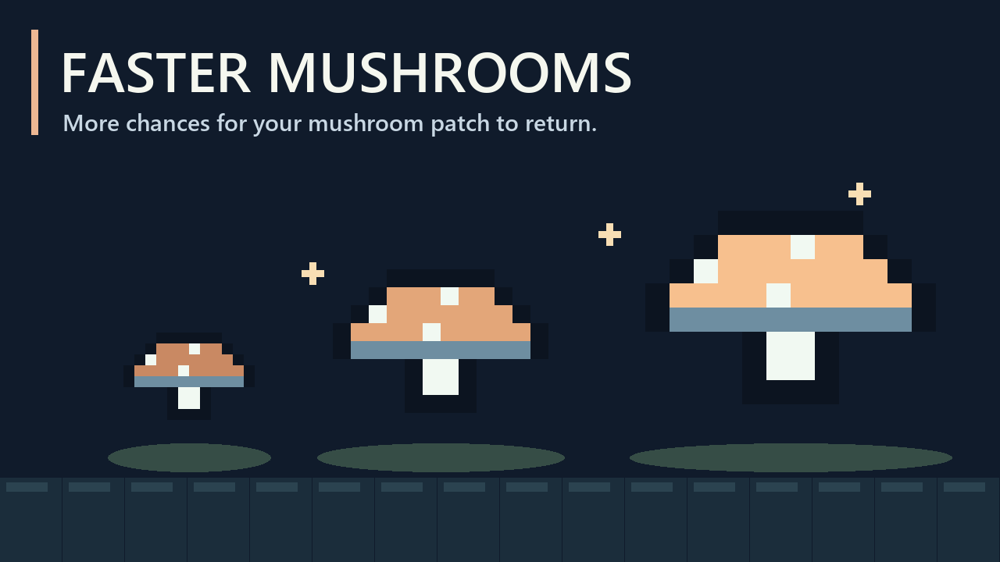

# Faster Mushrooms

Shorten mushroom growth waits and give wild mushrooms more chances to return near your base.

## Settings

Open **Settings > Mod Options > Faster Mushrooms**.

| Setting | Default | Choices |
|---|---|---|
| Mushroom growth speed | **4x** | Preset speeds from 1x to 100x |
| Wild mushroom respawn | **1 min** | Off, 15 s, 30 s, 1 min, 2 min, 5 min, 10 min, 30 min |

Growth speed shortens applicable mushroom spread and growth-stage timers. Wild respawn is a separate setting: at each interval, the game gets another chance to spawn mushrooms in areas within 48 tiles of players.

Changes apply during play and save automatically. Use **1x growth and Off respawn** for normal behavior going forward; already-shortened countdowns are not rewound.

## What to expect

Respawn intervals are **checks, not guaranteed spawns**. The game still requires suitable ground and biome, available space, and distance from players. It does not spawn mushrooms within six tiles of a player. Areas already containing many mushrooms get fewer new ones.

Other crops, drops and harvesting rules stay the same. Growth stages that require watered ground still require it.

## Requirements and limits

Requires **CoreLib** and **Mod Options**. Install on the host/server and all clients, then restart Core Keeper. The host/server's settings control growth and respawn.

Mushrooms are identified by their game object names; differently named custom plants may not be affected. While a mushroom respawn request runs, other environment-spawn entries are briefly suppressed. A normal respawn occurring at the same time can skip its non-mushroom objects once.
