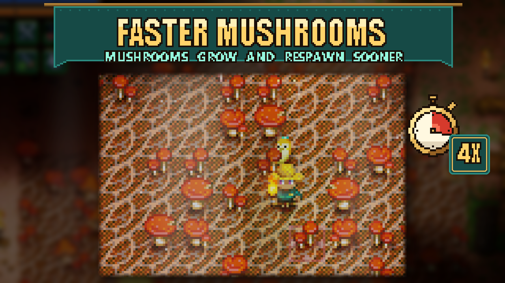

# Faster Mushrooms

Makes mushrooms grow and spread faster. It can also give wild mushrooms more chances to come back around you, so you don't have to wait as long between harvests.

## Settings

Open **Settings > Mod Options > Faster Mushrooms**. There are two separate settings:

| Setting | Default | Choices |
|---|---|---|
| Mushroom growth speed | **4x** | Preset speeds from 1x to 100x |
| Wild mushroom respawn | **1 min** | Off, 15 s, 30 s, 1 min, 2 min, 5 min, 10 min, 30 min |

Growth speed shortens the wait for mushrooms to spread and move through their growth stages. Wild respawn gives mushrooms another chance to appear within **48 tiles** of players each time the interval comes around.

That doesn't mean a mushroom will appear every minute. The ground and biome still need to be suitable, there needs to be space, and mushrooms won't spawn within **six tiles** of a player. Areas with lots of mushrooms already get fewer new ones. If a growth stage needs watered ground, you'll still need to water it.

Changes take effect while you play and save automatically. Set growth to **1x** and respawn to **Off** to go back to normal. Any countdowns that were already shortened will finish as they are.

## Installing

Requires **CoreLib** and **Mod Options**. The host and everyone joining need them and Faster Mushrooms installed. Restart Core Keeper after installing. In multiplayer, the host's settings decide how fast mushrooms grow and respawn.

Other crops, drops, and harvesting work as usual. Custom mushrooms from other mods might not be affected.

One limitation: when the mod checks for new mushrooms, it briefly pauses other things that naturally spawn in the environment. If the game's normal spawn check happens at that same moment, those other things can miss one spawn attempt.
