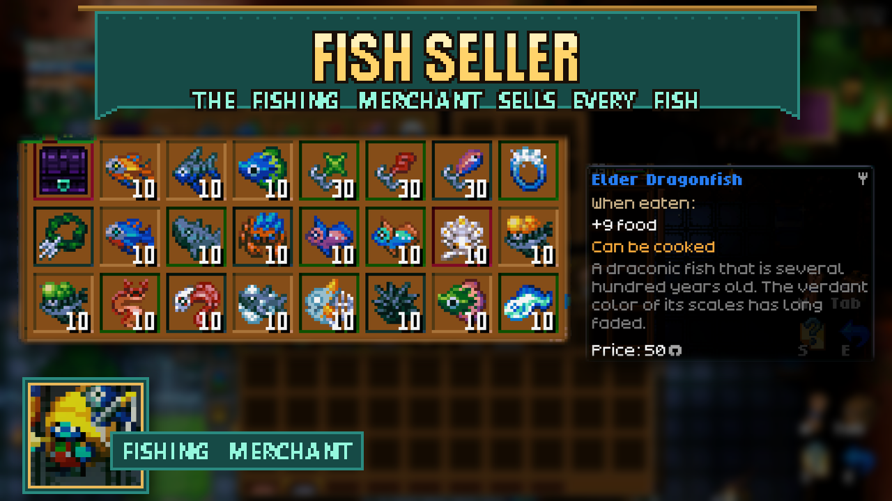

# Fish Seller

The Fishing Merchant sells all 44 supported fish, including Starlight Nautilus, so you can buy ingredients when you want to cook without going fishing. The Caveling Merchant also sells Shiny Larva Meat.

Talk to the merchants as usual. The ingredients appear alongside their existing stock and need no extra unlocks. Merchants already in your world get a one-time restock when the new items are added.

## Browsing the shop

Hover over the shop and scroll with the mouse wheel to see the rest of the stock. The window has eight columns and three visible rows, with a scrollbar for the remaining items. Scrolling works in other large merchant shops too, and won't change your hotbar while the pointer is over the shop.

**Controller scrolling isn't supported yet.** With a controller you can reach the first three rows; use the mouse wheel for later rows.

## Prices and stock

Open **Settings > Mod Options > Fish Seller** to change these settings:

- **Price multiplier:** 0.25x, 0.5x, 0.75x, 1x, 1.5x, 2x, 3x or 4x. The default is **1x**, and it only changes buying prices.
- **Stock per restock:** 1–99 of each added item. The default is **10**.

At 1x, ordinary fish use the game's usual buy-price formula: five times their sell value. Starlight Nautilus costs **500 coins** at 1x. Sell prices stay unchanged. If you buy a Nautilus with a full bag, it drops at your feet.

## Requirements and multiplayer

For Core Keeper **1.3.0**. Install **Fish Seller, CoreLib and Mod Options** on the host and every client. The host's settings determine prices and stock in multiplayer.

Fish Seller works alongside More NPCs and Potion Seller (1.4.0 or newer). Potion Seller's Titan summons and Ender Stash's chest remain in the Fishing Merchant's shop. Merchant Restock can shorten the wait for refills.

Locked wares appear at the end of merchant lists. This prevents an issue where the shop would repeatedly restock.

Cover is made from in-game screenshots of the Fishing Merchant and its shop (HDR captures tone-mapped); title banner and label added.
