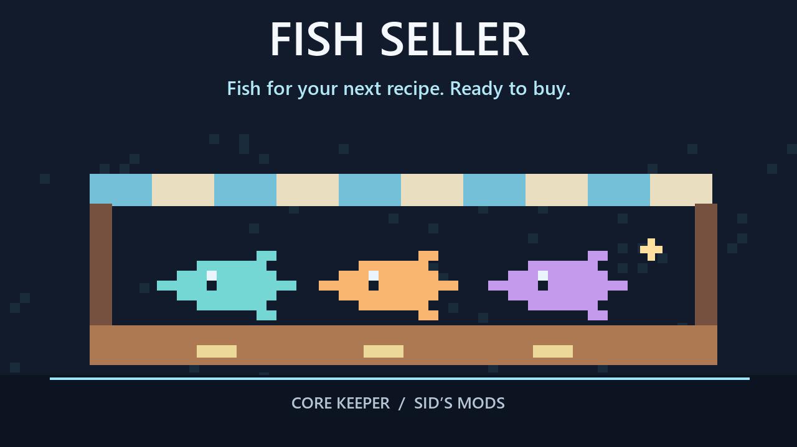

# Fish Seller

Buy cooking ingredients without a fishing trip: the **Fishing Merchant stocks all 44 supported fish**, including Starlight Nautilus. The **Caveling Merchant also sells Shiny Larva Meat**.

## Visit the shop

Talk to the usual merchants. The added ingredients need no extra unlocks and appear alongside their existing stock.

**Hover over a shop and use the mouse wheel to scroll.** Shops show eight columns and three rows, with a scrollbar for the rest. This works for other merchants with large inventories too, and the wheel will not change your hotbar while you hover over the shop.

## Prices and settings

Open **Settings > Mod Options > Fish Seller**.

| Setting | Choices | Default |
|---|---|---|
| Price multiplier (buying only) | 0.25x, 0.5x, 0.75x, 1x, 1.5x, 2x, 3x, 4x | 1x |
| Stock per restock | 1–99 of each added item | 10 |

At the default multiplier, ordinary fish use the game's usual buy-price formula (five times their sell value). **Starlight Nautilus costs 500 coins at 1x**. Sell prices stay unchanged. If your bag is full when buying the Nautilus, it drops at your feet.

## Requirements and limits

Requires **CoreLib and Mod Options** on the host and every client. The host's settings control multiplayer prices and stock.

- Use **Potion Seller 1.4.0 or newer** if you also run it. Its summons and Ender Stash's chest remain in the Fishing Merchant's stock.
- Pair with **Merchant Restock** to shorten the wait for refills.
- Existing merchants receive a one-time restock when the new wares are first added.
- **Controller scrolling is not supported yet.** A controller can access the first three rows; use the mouse wheel to reach later rows.

The mod also places locked wares at the end of merchant lists to prevent an unintended repeated-restock issue.
