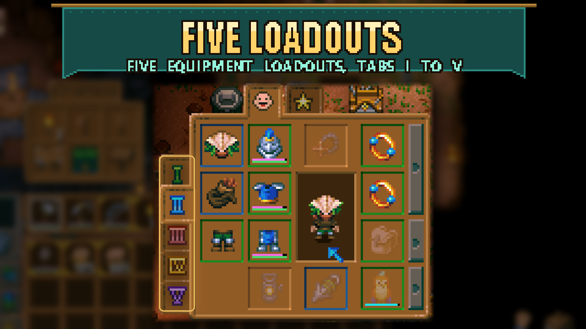

# Five Loadouts

Adds two more equipment loadouts, so you have five instead of three. You can keep a mining or fishing set ready without giving up one of your combat setups.

## Switching loadouts

Open your character window and click the new **IV** or **V** tab. The usual cycle-loadout control goes through all five too.

If you'd rather jump straight to one, set keys for **Equip loadout 4** and **Equip loadout 5** under **Controls > Five Loadouts**. Neither has a key assigned by default. There are no other settings.

The extra loadouts have their own armor, jewelry, and off-hand slots. With the required **Vanity Slots & Shared Equipment** mod, they also get their own bag, lantern, and pet slots. Leave a slot empty to borrow from the nearest earlier loadout. Your four pouch slots are still shared.

## Installing

You'll need **CoreLib**, **Vanity Slots & Shared Equipment** (formerly Loadout Fallback), and **Mod Options**, which Vanity Slots & Shared Equipment uses. In multiplayer, the host and everyone joining need Five Loadouts and these requirements installed. Restart Core Keeper after installing; existing characters get the extra slots automatically.

## Before removing it

**Empty loadouts 4 and 5, then switch to loadout 1, 2, or 3 before uninstalling.** Without the mod, you won't be able to reach the extra slots, and your character needs to be saved on one of the original three loadouts.

If you use other mods that add inventory slots, empty those slots before changing which mods are installed or their load order. Moving them around while they're holding gear can cause problems.
