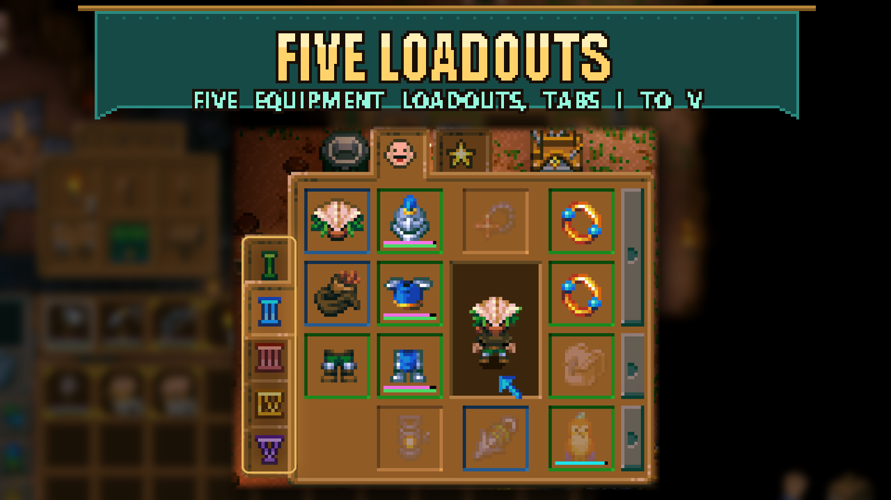

# Five Loadouts

Keep five equipment setups ready instead of three. Add dedicated loadouts for mining, fishing, exploration or combat without rebuilding your gear each time.

## How to use it

Open your character window and select the new **IV** or **V** tab. Your existing cycle-loadout control now cycles through all five setups. No settings are needed.

To jump straight to loadout IV or V, bind **Equip loadout 4** and **Equip loadout 5** under **Controls → Five Loadouts**. They start unbound so they never clash with your existing keys.

Each extra loadout has its own armor, jewelry and off-hand slots. **Loadout Fallback** also gives it a separate bag, lantern and pet slot, and empty slots borrow gear from the nearest earlier loadout. The four pouch slots stay shared.

## Requirements

Requires **CoreLib** and **Loadout Fallback**. Install them on the host/server and every client, then restart Core Keeper. Existing characters receive the extra slots automatically.

## Limits and removal

- **Before uninstalling, move all items out of loadouts 4 and 5 and switch to loadout 1, 2 or 3.** Added slots are not available without the mod, and the saved active loadout must be a vanilla one.
- Mods that add player inventory slots depend on a stable layout. Avoid changing their combination or load order while gear remains in added slots.

The implementation and earlier integration notes are in this folder's source files. The current Loadout Fallback already contains the Five Loadouts integration; no manual source patch is needed.
