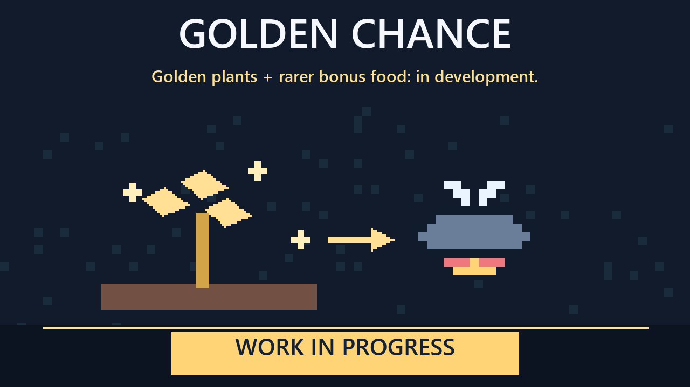

# Golden Chance — Work in Progress

**WORK IN PROGRESS: this mod is still being developed and tested.** The settings below describe the current source's intended behavior, not a guarantee that every planting, cooking or multiplayer case works. The published Workshop files may differ from this development version.

The goal is to let you increase the odds of **golden plants** and **rarer bonus cooked food**, with a separate control for each.

## Current development settings

Open **Settings > Mod Options > Golden Chance**.

| Setting | Choices | Default |
|---|---|---|
| Golden plant chance bonus | +0% to +100%, in steps of 5 | +0% |
| Golden food chance bonus | +0% to +100%, in steps of 5 | +0% |

These are intended as percentage-point additions: a 20% chance with a +5% bonus becomes 25%. At +0%, this mod leaves the talent value unchanged. The source attempts to apply bonuses even with no points in the relevant talent.

The food setting targets the rarity upgrade roll for **extra food produced by the Cooking skill**. It does not target every cooked dish or increase the chance of making extra food. Already planted seeds keep their earlier outcome; automated seeders that ignore player talents are outside this approach.

## Requirements and testing status

Requires **CoreLib and Mod Options** on the host and every client. Use the standalone mod or Sid's Overhaul, not both.

The current implementation refreshes player talent conditions on joining a world, changing settings and changing talent points. Live multiplayer behavior still needs an in-game check. Interaction with Auto Replant's base-chance override also needs to be evaluated as part of the unfinished feature.

## For contributors

The current source is the 2.0.0 additive-bonus design, replacing older talent multipliers. A managed talent-value patch changes the plant and bonus-food conditions, then sends them through the game's existing condition commands. It does not patch the game's compiled planting or cooking jobs. Old multiplier configuration keys are unused.
