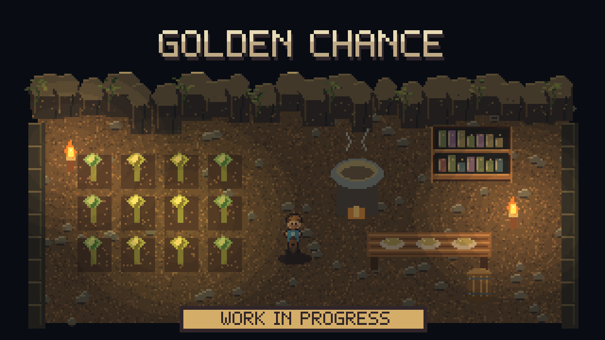

# Golden Chance

Golden Chance lets you raise the chance of growing golden plants and getting rarer bonus food from cooking. Both bonuses start at **+0%**, so nothing changes until you choose a higher value.

Open **Settings > Mod Options > Golden Chance**. **Golden plant chance bonus** and **Golden food chance bonus** each range from +0% to +100%, in steps of 5. These add percentage points: a 20% chance with a +5% bonus becomes 25%, up to a maximum of 100%. They work even with no points in the relevant talent. At +0%, the game's talent value is left alone.

The cooking setting only changes the rarity of **extra food produced by the Cooking skill**. It does not make extra food appear more often or upgrade your regular main dish. Already planted seeds keep the outcome they had when planted. Automated seeders that do not use player talents are unaffected; automatic replanting can also apply its own base-chance override.

## Installation and multiplayer

For **Core Keeper 1.3.0**. Install **CoreLib** and **Mod Options** on the host and every client, along with Golden Chance. You can also use the copy included in **Sid's Overhaul**; choose either the bundle or the standalone mod. Restart the game after installation so the new patches load.

Each client uses its own saved talent points, rather than the host's points.

## Updating from 2.1.0

Version 2.2.0 removed the option to upgrade regular main dishes because it interfered with a game optimization even while switched off. Old saved values for that option are ignored, and food already upgraded stays as it is.

## Testing

The Overhaul version has passed the game's loading checks. Standalone use, multiplayer, and talent resets/rejoining still need in-game testing.

[Implementation and test details](https://github.com/Sthakur27/corekeeper-mods/blob/main/GoldenChance/DEVELOPER.md)

Cover is an in-game screenshot of a farm with golden crops; close-ups and title banner added.
