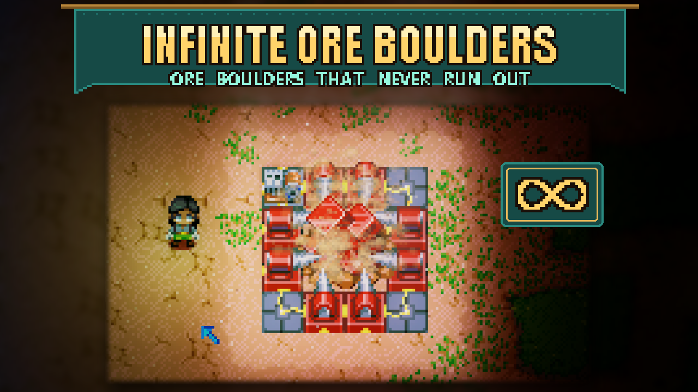

# Infinite Ore Boulders

Ore boulders keep producing ore without running out, so you can leave your drills where they are instead of moving them to a new deposit.

Enable the mod, then mine or drill an existing boulder as usual. There are no settings or extra controls. It works with the game's ore boulder types, including pandorium and relucite, and keeps the normal ore drops and progress toward the next drop.

Only ore boulders are protected. Ordinary rocks and ore walls stay unchanged, and the mod won't create new boulders or restore ones that have already disappeared. Extremely large bursts of damage are capped to keep the boulder alive.

## Installation and multiplayer

For Core Keeper 1.3.0. No library dependencies are needed. In multiplayer, install it on the host and every client; the host handles boulder protection.

Cover is an in-game screenshot of drills around an ore boulder (HDR capture tone-mapped); title banner and infinity sign added.
