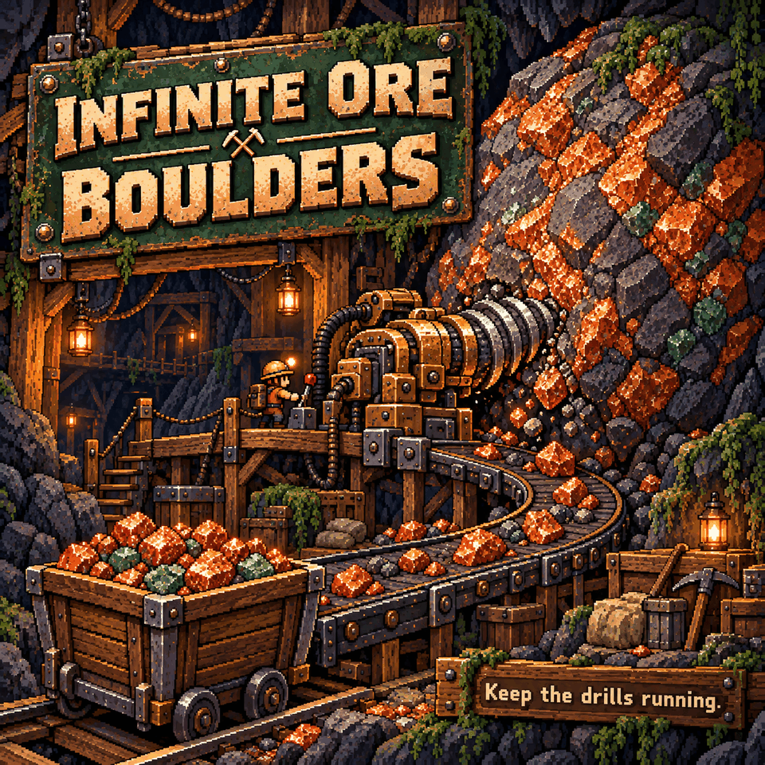

# Infinite Ore Boulders

Keep your mining operation running: **ore boulders keep producing ore without being used up**. You can leave drills in place instead of finding a new boulder when one runs out.

## How to use

Enable the mod and mine or drill an existing ore boulder as usual. There are no settings. It covers the game's ore boulder types, including pandorium and relucite.

The mod preserves the game's ore-drop process and protects boulders from breaking. It does not create new boulders or bring back ones that have already disappeared.

## Requirements and limits

No library dependencies. Install on the host and every client in multiplayer; the host runs the boulder protection.

Only ore boulders are protected. Ordinary rocks and ore walls are unchanged. Extremely large bursts of damage are capped to keep the boulder alive.
