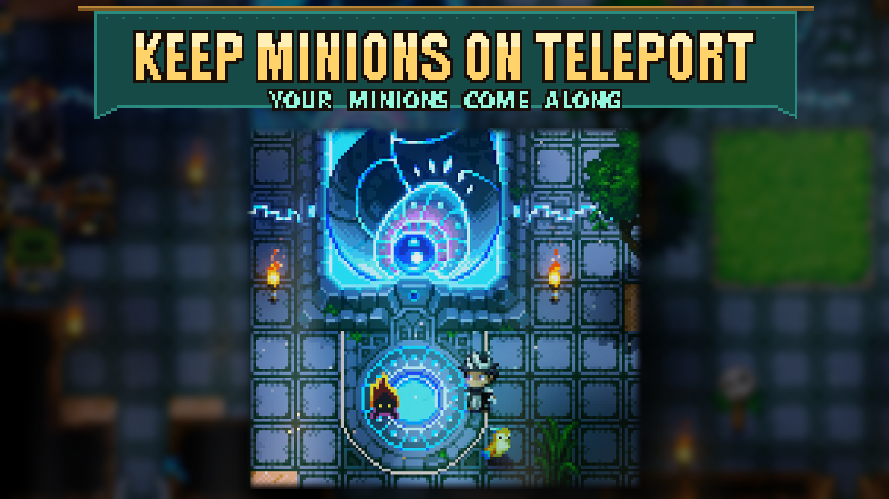

# Keep Minions On Teleport

Your summoned minions come along when you use a portal, waypoint or recall, so you don't have to summon them again after each trip. Summon them and teleport as usual. There are no keys or settings to configure.

Once you arrive, minions more than 32 tiles away move beside you. This catch-up also works outside teleports, so minions that get that far behind can return to you during normal travel. Dying still dismisses them, and their normal lifespan and combat stats stay the same.

No extra library mods are required. In multiplayer, install Keep Minions On Teleport on the host/server and every player's game; the host handles moving the minions. Restart the game after installing.

This is also included in **Sid's Overhaul**. If you use the Overhaul, you don't need a separate copy.
