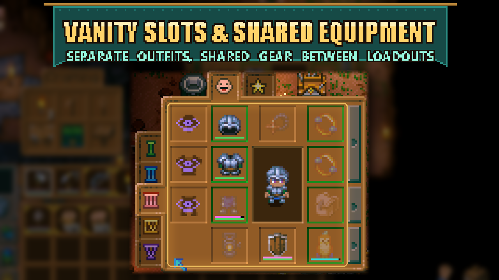

# Vanity Slots & Shared Equipment

Adds vanity slots for each loadout, so you can give each one its own outfit. Empty equipment slots can also borrow gear from earlier loadouts, so you don't need extra copies of the same items.

Previously called **Shared Loadout Gear & Vanity**, and before that **Loadout Fallback**. It's the same mod.

## Vanity outfits

You also get three vanity slots beside your armor for a cosmetic helmet, chest, and pants. Each loadout can have its own outfit. Using vanity furniture changes the outfit for your current loadout too.

With **Vanity fallback** turned on (the default), empty vanity slots borrow from earlier loadouts just like gear does. Click a dimmed vanity piece to hide it in this loadout; click again to bring it back. Your other loadouts keep their outfits.

You can turn Vanity fallback off in **Mod Options**. Empty vanity slots then show your actual armor, and clicking one hides or shows that piece.

Other players can see your outfits, but the fallback setting is personal: how they see empty vanity slots depends on their own setting.

## Sharing gear

Put your usual gear in loadout 1, then only add the pieces you want to swap in your other loadouts. Empty slots borrow from an earlier loadout, so you don't need another copy of the same helmet, bag, or pet.

An empty slot checks the loadout before it, then keeps going back until it finds an item. So an empty helmet slot in loadout 3 uses loadout 2's helmet, or loadout 1's if both are empty. If you use **Five Loadouts**, this carries on through loadouts 4 and 5.

Borrowed items look dimmed, with their real durability. Drag an item into a dimmed slot to use something different in that loadout. Take it out and the slot goes back to borrowing. To move or remove the original item, go to the loadout that holds it.

This works for armor, jewelry, off-hand, bag, lantern, and pet. Your bag space and appearance follow whichever gear you're using.

**Use drag-and-drop or shift-click from your inventory when changing borrowed gear.** Right-clicking gear on the hotbar can replace the original item in an earlier loadout instead.

## Installing

You'll need **CoreLib** and **Mod Options**. In multiplayer, the host and everyone joining need the mod and its requirements installed. Restart the game after installing.

Avoid running another mod that changes how equipment loadouts work at the same time.

**Empty the added equipment slots before uninstalling**, or before changing other mods that rearrange your inventory slots.
