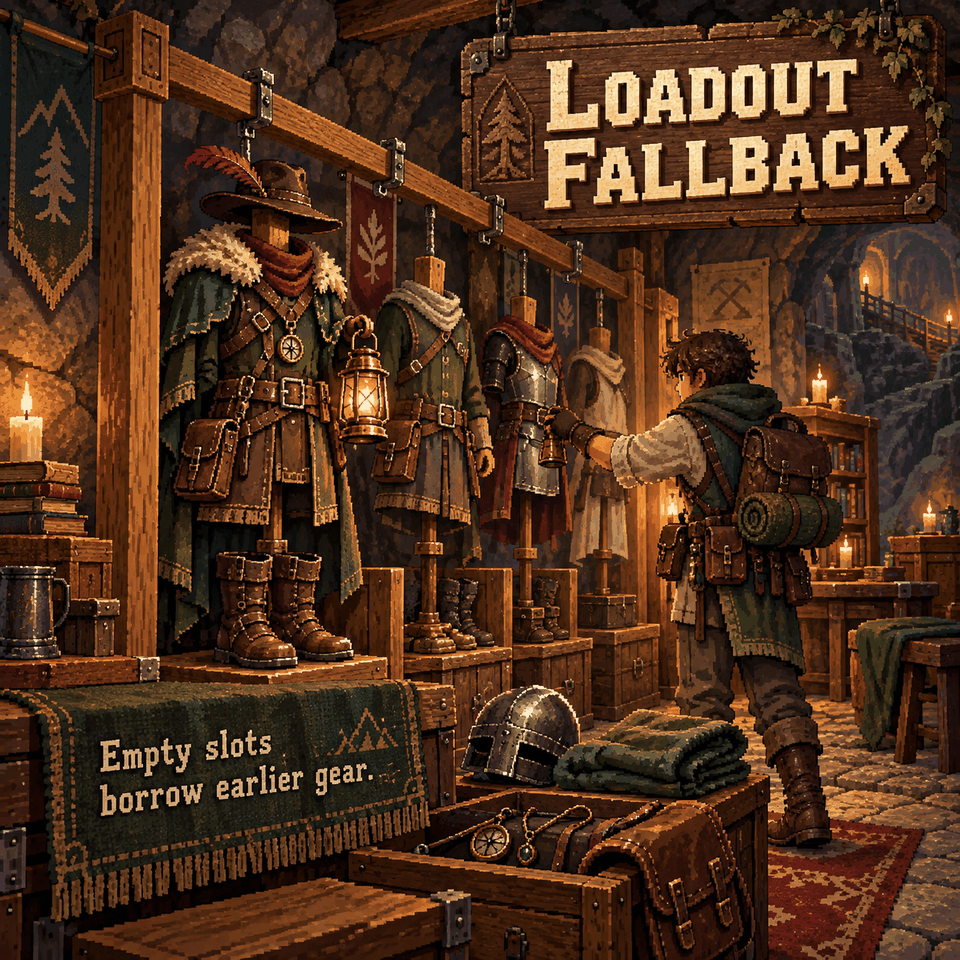

# Loadout Fallback

Share your best gear across loadouts without moving it back and forth. Empty equipment slots borrow the nearest earlier loadout's item automatically.

## How to use it

Put your everyday gear in loadout 1, then add only the items you want to change in loadouts 2 and 3. For example, an empty helmet slot in loadout 3 uses loadout 2's helmet, or loadout 1's if both are empty.

- Borrowed items appear **dimmed** and show their real durability.
- Drag an item onto a dimmed slot to give that loadout its own item. Remove it to borrow again.
- To change or remove a borrowed item, go to the loadout that owns it.
- Armor, jewelry, off-hand, bag, lantern and pet follow this rule. Bag capacity and appearance update with your active gear.

With **Five Loadouts**, the same rule continues through loadouts 4 and 5. There are no settings.

## A different outfit for each loadout

Three vanity slots beside your armor let you choose a cosmetic helmet, chest and pants for each loadout. Empty vanity slots show the real armor; clicking an empty slot toggles hiding that piece. Vanity furniture also edits your current outfit, which other players can see.

The in-window slot idea was inspired by **Vanity Slots**; this is a separate implementation. If that mod adds its slots first, Loadout Fallback reuses them.

## Requirements and limits

Install on the host/server and all clients, then restart the game. No library dependency is required. Keep **Loadout Plus** disabled because this mod replaces its equipment behavior.

**Use drag-and-drop or inventory shift-click for borrowed slots.** Right-clicking gear on the hotbar can replace the earlier loadout's original item instead of creating an override in your current loadout.

This mod adds equipment slots. Move items out of added slots before removing it or changing other mods that alter the player inventory layout.
