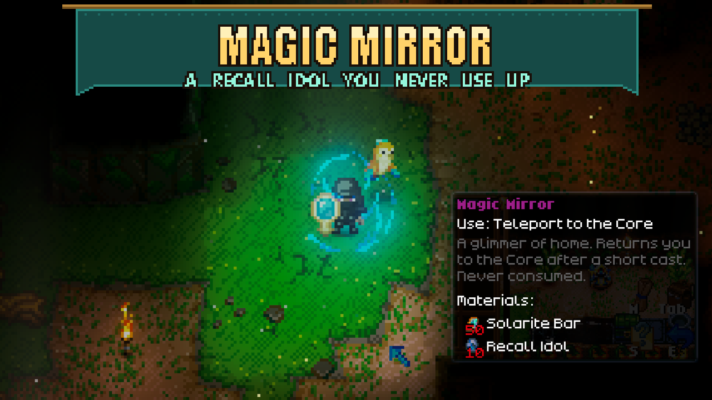

# Magic Mirror

Magic Mirror adds a reusable item that takes you back to the Core. Hold it and use it like a Recall Idol: after a three-second cast, the normal teleport sequence begins. Moving or changing your held item cancels the cast.

You keep the mirror after using it. It has no durability and needs no fuel or recharge. Ordinary Recall Idols still work as usual and are consumed when used.

## Getting a mirror

Craft one at the **Solarite Workbench**, in the **Gear** category, for **50 Solarite Bars and 10 Recall Idols**. Existing benches gain the recipe automatically. Higher-tier benches that include Solarite recipes can craft it too.

**Omoroth the Sea Titan has a 20% chance to drop one mirror per defeat.** The mirror drops at the boss's position in addition to the normal loot. In multiplayer, everyone shares one roll per boss; each player does not get a separate roll.

## Installing and playing

For Core Keeper **1.3.0**. The standalone mod needs no libraries and has no settings. Windows and Linux asset bundles are included. In multiplayer, install it on both the host and every client.

Subscribe on the Workshop, then restart Core Keeper. For a manual install, extract the archive into `CoreKeeper_Data/StreamingAssets/Mods/MagicMirror` with `ModManifest.json` directly inside that folder, then restart.

Magic Mirror is also included in Sid's Overhaul. Choose the standalone mod or the bundle; do not install both copies. The Overhaul's feature switch stops crafting and use. Existing mirrors remain items, and re-enabling the feature and restarting restores their use.

The recipe needs one of the four normally empty Solarite Gear slots. If other recipes occupy all four, Magic Mirror leaves them alone and its crafting recipe will not appear.

Remove mirrors from inventories and storage before uninstalling the mod.

## Testing notes

The [October 2026 validation record](https://github.com/Sthakur27/corekeeper-mods/blob/main/MagicMirror/Tests/VALIDATION.md) leaves in-world gameplay and remote multiplayer checks unconfirmed. It does not establish the testing status of later versions.

Build instructions, implementation notes and earlier changes are in the [developer notes](https://github.com/Sthakur27/corekeeper-mods/blob/main/MagicMirror/DEVELOPER.md).

Cover is made from in-game screenshots (mirror cast and crafting tooltip, HDR captures tone-mapped); title banner added.
