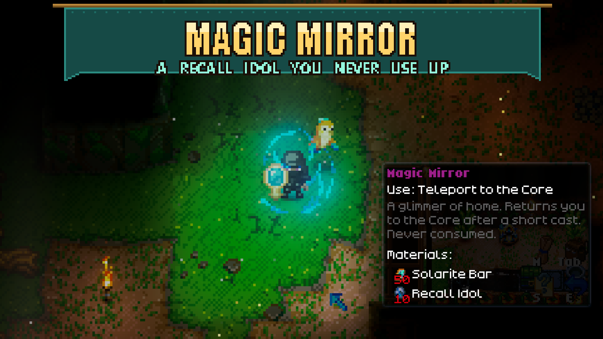

# Magic Mirror

Craft a permanent way home: **50 Solarite Bars + 10 Recall Idols → 1 Magic Mirror** at the **Solarite Workbench**, in its Gear category. Higher-tier benches that include Solarite recipes can craft it too.

**Omoroth the Sea Titan also has a 20% chance to drop one Magic Mirror per defeat.** This is an independent bonus drop at the boss's position, in addition to its normal loot. Multiplayer shares one roll per boss, not one roll per player. No Boss Bonus Loot dependency is required.

Equip the mirror and use it as you would a Recall Idol. After a three-second cast, it uses the game's normal teleport sequence to return you to the Core. The mirror is never consumed, has no durability, and needs no fuel or recharge. Moving or changing the held item cancels the cast. Recall Idols remain unchanged.

The mod includes original pixel art, an inventory icon, item text, and Windows/Linux asset bundles. No library dependencies or settings are needed. Install on both the host and clients in multiplayer.

### 1.0.3

- Crafting now requires 50 Solarite Bars and 10 Recall Idols. Existing mirrors and the 20% Omoroth drop are unchanged.

### 1.0.2

- Add an independent 20% chance for Omoroth to drop one Magic Mirror. The crafting recipe remains available.

### 1.0.1

- Register the recipe in the workbench's original recipe list so the game's periodic prerequisite refresh cannot erase it and cause flickering.
- Replace the dark purple icon outline with shaded gold edges and lighter blue glass to better match Solarite equipment.

## Install

Subscribe to the standalone Workshop item, or extract the manual archive into `CoreKeeper_Data/StreamingAssets/Mods/MagicMirror` so `ModManifest.json` sits directly inside that folder. Restart Core Keeper. Developers can also run `install.ps1` from the source checkout. Existing Solarite Workbenches gain the recipe automatically. Do not run the standalone version alongside an Overhaul version that already includes Magic Mirror.

The recipe uses an empty Solarite Gear slot without replacing other recipes. If another mod fills all four empty Gear slots, this mod leaves those recipes intact and cannot expose its recipe.

Remove mirrors from inventories and storage before uninstalling the mod. In Sid's Overhaul, its feature switch stops crafting and use; existing mirrors remain items and can be used again when the feature is re-enabled after a restart.

Cover is made from in-game screenshots (mirror cast and crafting tooltip); title banner added.

## Development

- `python MagicMirror/Unity/make_art.py`: regenerate the in-game sprites and a procedural reference image.
- `python MagicMirror/Unity/build_bundle.py`: build with Unity 6000.0.59f2 and the official Core Keeper Mod SDK. Requires EnderStash assets already built in that SDK. `--skip-import` skips reimporting game assemblies.
- `python MagicMirror/Unity/compile_check.py`: compile runtime scripts against local game assemblies.
- `python MagicMirror/Tests/check_recipe.py`: regression checks for master-list persistence, inherited recipes, idempotency, and coexistence with other mods' recipes.
- `python MagicMirror/Tests/check_assets.py`: validate the actual Windows/Linux bundles and their artwork.
- `python release/build_overhaul.py`: include the feature in Sid's Overhaul.

`Bundles/` is standalone. `OverhaulBundles/` combines Magic Mirror and Ender Stash data blocks, because the game registers only one data-block loader per mod GUID. Both builds use vanilla prefab components, with no assembly-name-dependent mod MonoBehaviours.

The cast system runs before vanilla's Burst player-state systems in both predicted worlds. It uses the existing replicated casting state and requests vanilla's teleport state without enqueuing an inventory consumption. No custom components are added to players. The authoring hook inserts the recipe before vanilla caches its unfiltered recipes and prerequisites; the recipe updater also handles already-placed workbenches.

See `Tests/MANUAL.md` for the in-world verification checklist.
