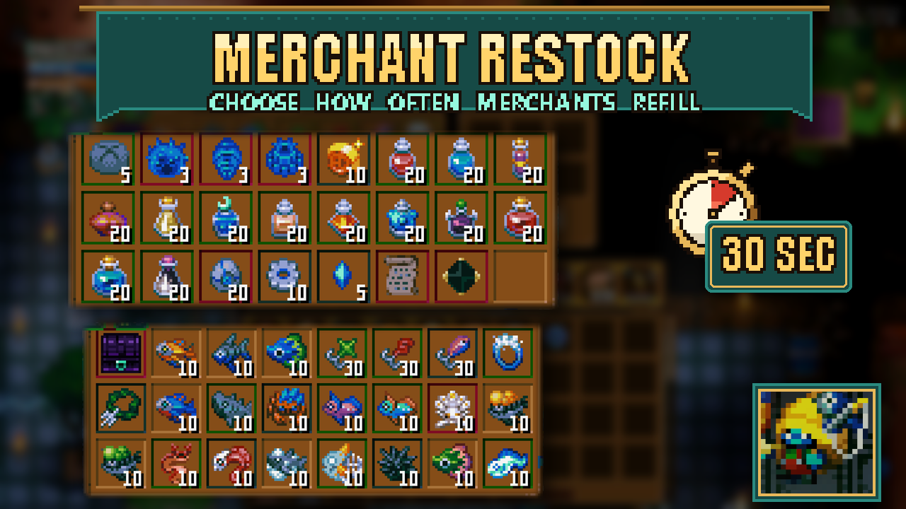

# Merchant Restock

Merchant Restock lets you shorten the wait for merchants to refill their shops and stock more of each item. Set one restock time for all six supported merchants, or give each merchant a different time. It does not change prices or add items.

Open **Settings > Mod Options > Merchant Restock** to choose a time:

- **All merchants**: Vanilla (25-35 min), 15 min, 10 min, 5 min, 2 min, 1 min or 30 sec. The default is **Vanilla (25-35 min)**.
- **Caveling, Slime, Fishing, Crystal, Void and Seasonal Merchant**: Same as all, or any of the times above. Each defaults to **Same as all**.

**Minimum stock per item** (Off, 10, 25, 50 or 99; default **Off (vanilla)**) raises how many of each regular stackable item the six merchants stock per restock. Gear and premium goods the game stocks only 1-3 of stay as they are, and nothing is added or made cheaper. Merchants refill straight away when you change it, and switching it off puts the normal amounts back. In Sid's Overhaul the same setting also applies to Fish Seller and More NPCs (they pick it up at their next restock); the standalone mods only change the six vanilla merchants.

**Quick buy:** hold **Shift** or **Ctrl** and click an item in a merchant's shop to buy the whole stack in that slot, or as many as your coins cover, in one go. The game still checks your coins and the merchant's stock. If your cursor already holds a different item, the click buys one as usual. Turn it off with **Shift/Ctrl-click buys the whole stack**.

The game still varies the time between refills. For example, **5 min** gives roughly **3.5-5 minutes**, rather than exactly five minutes every time. Leaving every setting at its default keeps the normal timers.

A shorter setting reduces an existing countdown if it is above the chosen limit. Choosing a longer time, or switching back to Vanilla, does not lengthen a countdown already in progress.

Requires **CoreLib and Mod Options**. Install Merchant Restock and both dependencies on the host and every client; the host's settings control multiplayer shops.

Cover is made from in-game screenshots of the Caveling and Fishing Merchants' shops and the Fishing Merchant (HDR captures tone-mapped); title banner and a stopwatch icon added.
