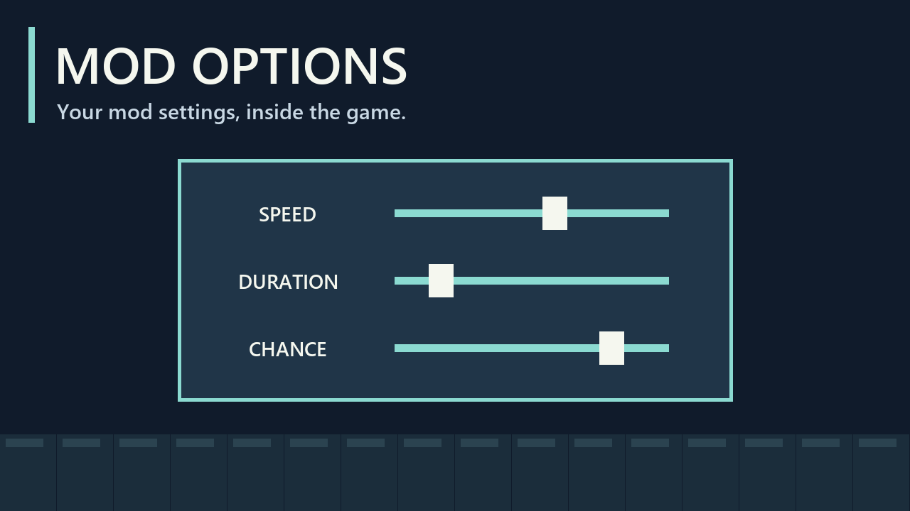

# Mod Options



Change supported mod settings from inside Core Keeper, using your mouse, keyboard or controller.

## Get started

1. Install **CoreLib** and **Mod Options**, then restart Core Keeper.
2. Open **Settings > Mod Options** from the main menu or pause menu.
3. Choose a mod, then adjust its options. Settings save automatically.

Click the left or right side of a value, or use left/right navigation. **Reset to defaults** resets the current page; select it twice to confirm.

## Requirements and compatibility

Requires **CoreLib**. Install on the host/server and clients when using mods that require this library. Only mods that register a page appear here; it does not add controls for every installed mod.

Built into **Sid's Overhaul**. The standalone mods use this separate library. It can coexist with Mod Settings Menu, which has its own button.

## For modders

```csharp
using ModOptions;

private static Setting<string> _speed;

public void Init()
{
    SettingsPages.Create(this, "My Mod")
        .Hint("What this mod does.")
        .Choice(out _speed, "Speed", new[] { "1x", "2x", "3x" }, "1x")
        .Build();
    _speed.OnChanged += token => Apply(token);
}
```

Controls: `Toggle` (bool), `Choice` (string list), `Stepper` (int range), and `Slider` (float range with a step). Read `Setting<T>.Value` or subscribe to `.OnChanged`.

`SettingsPages.Create(mod, title, keyPrefix)` supports several pages in one config file. Pages sort alphabetically; `.PinToTop()` places a page first. CoreLib saves values in `<mod name>/config.cfg`. The interface uses the game's menu navigation and scrolling.
