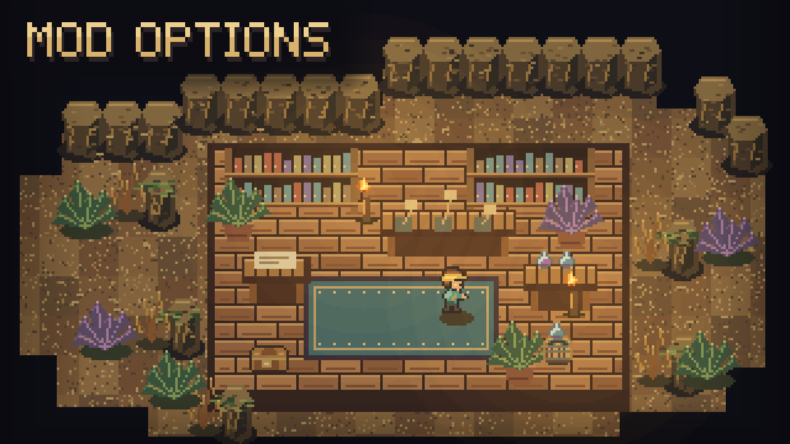

# Mod Options

Adds **Mod Options** to the game's settings menu, so you can change mod settings while you play. It works with a mouse, keyboard, or controller, and saves your changes automatically.

## Using the menu

Install [CoreLib](https://steamcommunity.com/sharedfiles/filedetails/?id=3673516180) and [Mod Options](https://steamcommunity.com/sharedfiles/filedetails/?id=3813531202), then restart Core Keeper. Open **Settings > Mod Options** from the main menu or pause menu and pick a mod.

Click either side of a value to change it, or use left and right on your keyboard or controller. If a page has **Reset to defaults**, select it twice to confirm.

Mod Options is already included in **Sid's Overhaul**. For standalone mods, install it when it's listed as a requirement. In multiplayer, follow the requirements of the mods you're using; some need it on both the host and everyone joining.

## Which mods show up?

Mods made to use Mod Options have their own pages. It can also pick up some settings from other mods that use CoreLib, with help text from the mod below each option. Keep CoreLib updated for this to work.

It won't find everything. Settings saved in a mod's own format, server or admin settings, keybindings, and free-text boxes won't appear. Automatically found settings only change your local options; they aren't shared with the server. Those pages don't have a reset-all button.

If a mod is missing, try closing and reopening the menu. Some mods load their settings later. Just opening the menu won't change any saved values.

Changes go back to the mod's usual settings file. **Restart required** means you'll need to restart before that option takes effect. Some mods need a restart even without that label, so try one if a change doesn't seem to do anything.

## Making a mod?

See the [developer notes](https://github.com/Sthakur27/corekeeper-mods/blob/main/ModOptions/DEVELOPER.md) for adding a settings page, which settings can be picked up automatically, and testing details.
