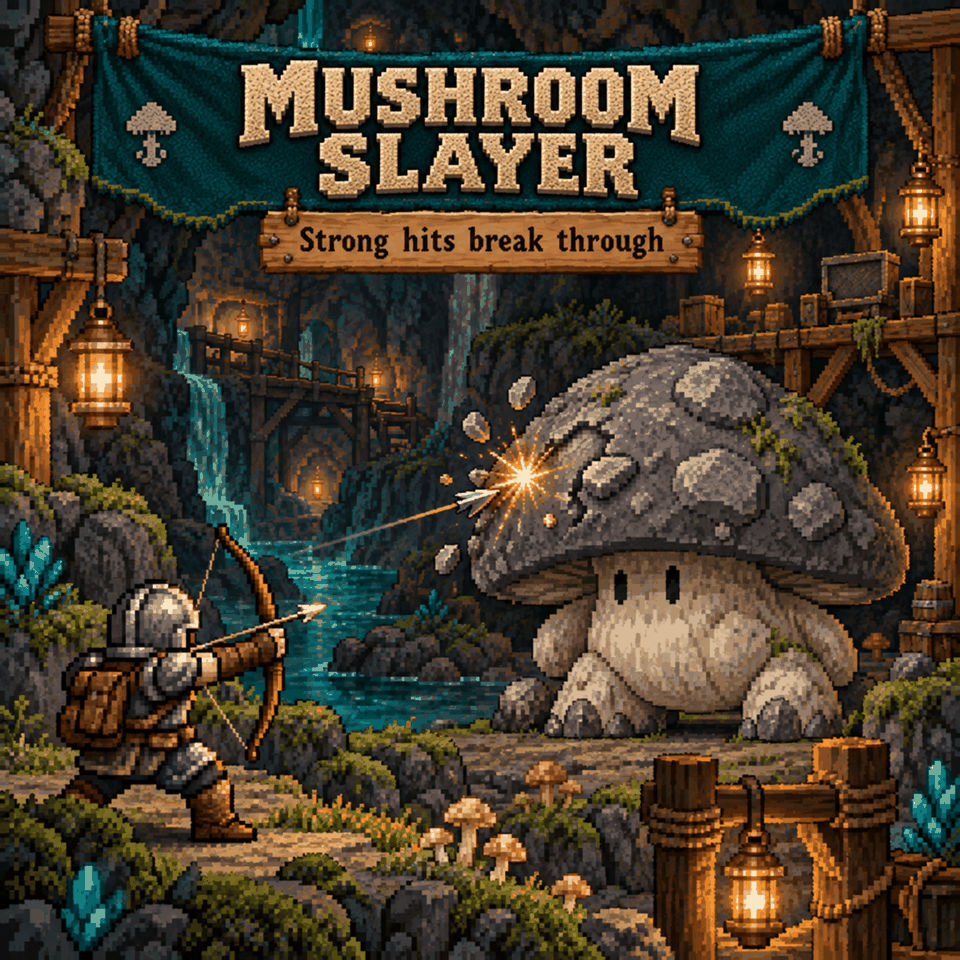

# Mushroom Slayer

Let powerful attacks punch through a Shrooman Brute's gray armor. Early-game hits still do one damage, while stronger builds can wear it down without waiting for a wall collision.

**Testing status:** the 1.1.0 bow fix is awaiting in-game verification. Standalone and Overhaul compile checks and damage-rule checks pass; live bow combat, damage numbers and multiplayer prediction are not yet confirmed.

## How damage works

With the default settings, while the brute is gray:

- A positive hit below **200** normal damage deals **1** damage.
- A hit of **200 or more** deals **10%**, rounded down.
- The vulnerable **red phase keeps its normal damage**.

| Normal hit | Gray-armored damage |
|---|---|
| 199 | 1 |
| 200 | 20 |
| 1,200 | 120 |
| 2,000 | 200 |

“Normal hit” means damage after bonuses, critical hits and ordinary flat damage reduction, before the gray armor's one-damage cap. Critical hits use the same rule. Zero-damage hits remain zero.

For a vanilla Hard-mode brute with 810 HP, five 2,000-damage hits would kill it, provided it does not heal. Health changes from other mods can change that count. An 8,100-damage crit can still kill it in one hit after the 90% reduction.

## Use and requirements

Open **Settings > Mod Options > Mushroom Slayer**. Settings save automatically and apply immediately:

| Setting | Default | Range |
|---|---|---|
| Damage threshold | 200 | 1–10,000 |
| Damage through armor (%) | 10% | 1–100% |

Hits below the threshold deal 1 damage. At or above it, damage uses the configured percentage, rounded down with a minimum of 1 for positive hits. Red-phase damage is unchanged. Reset to defaults restores 200 and 10%.

**Requires CoreLib and Mod Options** for the standalone mod. Sid's Overhaul includes Mod Options and requires CoreLib. Restart Core Keeper after installing or updating.

For a local install, run `install.ps1` from this folder. In multiplayer, install matching versions and use matching settings on the host and every client; multiplayer behavior still needs testing.

Sid's Overhaul 1.3.8 includes Mushroom Slayer as a switchable feature under **Settings > Mod Options > Turn Sub-Mods On/Off**. Use the bundled version or the standalone mod, not both.

## Limits

- Only Shrooman Brutes are targeted. Their health and phase timing are unchanged.
- Vanilla stuns can also make a brute vulnerable; that behavior remains intact.
- Explicit armor-bypass attacks and creative instant kills keep their existing behavior.
- Non-projectile pet/creature attacks and third-party attacks that already discard their original damage before the mod can read it retain their vanilla cap.
- Avoid combining this with another mod that changes the same brute armor or damage handling.

## For modders and testing

Direct hits are adjusted in the health-change queue. The projectile fix temporarily raises the cap only during projectile calculation, scales the newly queued hits, clears premature kill flags, and restores the cap before other systems run. Burst stays enabled. Already-scaled hits are skipped by the later health pass.

The current build logs the first 40 scaled server projectile hits and up to 80 brute health-queue entries. Look for `[MushroomSlayer:projectile] incoming=1200 applied=120` and `[MushroomSlayer:trace]` in Player.log. Run `python MushroomSlayer/Tests/run.py` for the rule checks; pending live checks are in [the test checklist](Tests/MANUAL.md).

