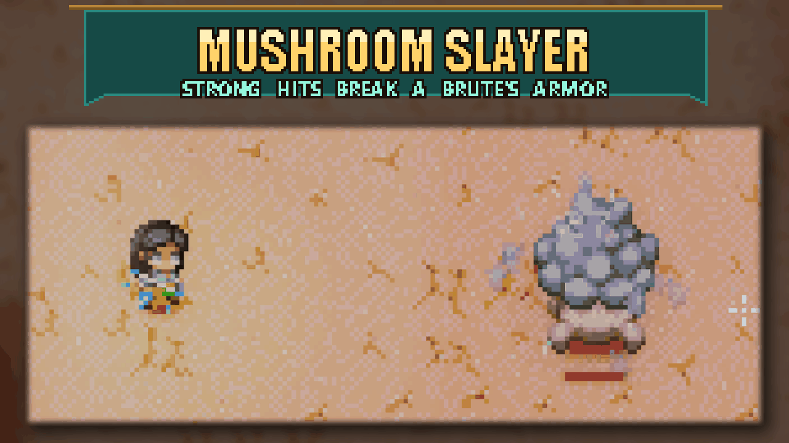

# Mushroom Slayer

Mushroom Slayer lets strong attacks damage a Shrooman Brute through its gray armor, so a stronger character can kill it without waiting for it to hit a wall. Weak attacks still deal one damage, and the vulnerable red phase works as usual.

With the defaults, hits below **200 damage** deal **1 damage** through gray armor. Hits of **200 or more** deal **10%** of their normal damage, rounded down:

| Normal hit | Damage through gray armor |
|---|---|
| 199 | 1 |
| 200 | 20 |
| 1,200 | 120 |
| 2,000 | 200 |

Normal damage here includes bonuses, critical hits and ordinary flat damage reduction, before the gray armor would cap the hit at one damage. Zero-damage hits stay at zero.

A vanilla Hard-mode brute has 810 HP, so five hits that would normally deal 2,000 damage will kill it, as long as it does not heal. An 8,100-damage critical hit can still kill it in one hit after the armor reduction. Changes to the brute's health will change those counts.

## Settings

Open **Settings > Mod Options > Mushroom Slayer**. Settings save automatically and take effect immediately.

| Setting | Default | Range |
|---|---|---|
| Damage threshold | 200 | 1–10,000 |
| Damage through armor (%) | 10% | 1–100% |

Below your threshold, positive hits deal one damage. At or above it, they use your chosen percentage, rounded down, with a minimum of one damage. These settings do not change red-phase damage. Reset to defaults restores 200 and 10%.

## Installation and multiplayer

For **Core Keeper 1.3.0**. The standalone mod requires **CoreLib** and **Mod Options**. Restart the game after installing or updating. For a local install, run `install.ps1` from this folder.

In multiplayer, the host and every client need matching mod versions and matching settings.

Mushroom Slayer is also included in **Sid's Overhaul**, which includes Mod Options and requires CoreLib. Use either the standalone mod or the bundle. In the bundle, turn this feature on or off under **Settings > Mod Options > Turn Sub-Mods On/Off**.

## What stays the same

Only Shrooman Brutes are affected. Their health, phase timing and vulnerability to vanilla stuns stay the same. Attacks that explicitly bypass armor and creative instant kills also keep their existing behavior.

Non-projectile pet and creature attacks still have the vanilla cap. Custom attacks that have already lost their original damage value before this mod can read it also keep that cap. Avoid combining changes to the same brute armor or damage rules.

Cover is an in-game screenshot of a fight with a Shrooman Brute (HDR capture tone-mapped); title banner and an animated damage number added.
