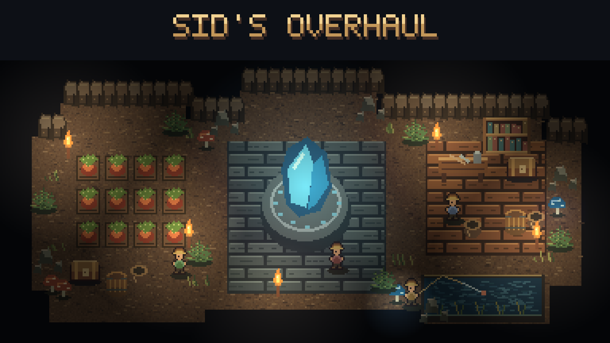

# Sid's Overhaul

Spend less time repeating chores and more time exploring. Sid's Overhaul brings the individual mods in this repository into one package: easier farming and fishing, equipment tools, merchant supplies, and adjustable combat and progression.

**New in 1.4.0: Runic Storage and smoother bases.** Craft its workbench from the Base section of a workbench. Storage units and sequential upgrade gems cost 30 bars of their tier. Empty its units before removing the mod, and disable the standalone Runic Storage mod when using this bundle. This release also removes per-tick inventory, merchant and farm work that grew with base size, and fixes a chest-skin mix-up that caused about 80 ms hitches near storage.

**From 1.3.9:** Magic Mirror crafting now also requires 10 Recall Idols, in addition to 50 Solarite Bars. Existing mirrors and the 20% Omoroth drop are unchanged.

**Included from 1.3.8: Mushroom Slayer.** Strong hits break through gray Shrooman Brute armor. Mod Options defaults: threshold 200, damage 10%; red phase unchanged. Bow combat and multiplayer await live testing. Match settings on host and clients. Includes Magic Mirror and the Golden Chance performance fix. Restart after updating.

## Install and get started

1. Subscribe to [Sid's Overhaul](https://steamcommunity.com/sharedfiles/filedetails/?id=3813043354) and [CoreLib](https://steamcommunity.com/sharedfiles/filedetails/?id=3673516180) on Steam Workshop.
2. Disable the separate versions of the included mods so the same features do not run twice.
3. Restart Core Keeper, then open **Settings > Mod Options** from the main menu or pause menu.

**Mod Options is built in.** You do not need a separate Mod Options subscription for the Overhaul. For multiplayer, install matching versions and CoreLib on the host and every client. World-changing settings generally use the host's values; local controls and cosmetic options are configured by each player.

Prefer to pick individual mods? Use [Sid's Core Keeper Mods collection](https://steamcommunity.com/sharedfiles/filedetails/?id=3814775238). For manual installation, see the [latest GitHub release](https://github.com/Sthakur27/corekeeper-mods/releases/latest) and the instructions inside its zip.

## What's included

| Feature | What it does |
|---|---|
| Loadout Fallback + Five Loadouts | Fill empty equipment slots from lower loadouts, use separate vanity outfits, and add two loadout tabs. |
| Ender Stash | A personal 40-slot stash accessed through an Ender Chest bought from the Fishing Merchant; travels with your character and stays safe on death. |
| Runic Storage | Craft a storage workbench, connect storage units, and upgrade them through eight tiers from 20 to 160 slots per unit. Search, filter and sort the shared inventory from a terminal or connected unit. Inspired by Magic Storage for Terraria. |
| Magic Mirror | Reusable three-second return to the Core. Craft for 50 Solarite Bars + 10 Recall Idols at a Solarite Workbench, or get one from Omoroth with a 20% chance per defeat. |
| Armor Dye | Color individual armor, weapons and tools with an inventory palette. |
| Pet Editor | Change pet levels, talents and colors through the pet window. |
| Auto Replant | Replant player-harvested crops on suitable planting ground using a matching nearby dropped seed or one you carry. |
| Bigger Watering Cans | Water a 2x2 or 4x4 patch with supported cans. |
| Faster Mushrooms | Tune spread and mushroom regrowth near players. |
| Fast Auto Fishing | Automate fishing and shorten waiting and animations; special boss fishing keeps its bite timing. |
| Better Fishing Loot | Adjust the chance of valuable non-fish fishing loot. |
| Potion Seller | Add potions, explosives and Titan summon items to merchant shops. |
| Fish Seller | Buy fish and Shiny Larva Meat, and scroll through expanded shops. |
| Merchant Restock | Choose a restock interval for all merchants or individual merchant types. |
| Infinite Ore Boulders | Keep drilling ore boulders without depleting them. |
| Quick Buff | Shortcuts for buffs (B), food only (F), a healing potion (H) and a mana potion (J), including items in pouches. |
| Buff Duration Floor | Set minimum durations for food and potion buffs. |
| Durability Multiplier | Choose how fast equipment wears out. |
| Difficulty Tuning | Separate enemy and boss settings for Hard and Normal worlds. |
| Mushroom Slayer | Configurable gray brute armor: hits below 200 deal 1; hits of 200 or more deal 10%. Red phase unchanged. |
| Boss Bonus Loot | Extra drops from selected bosses and enemies. |
| Skill XP Multiplier | Adjust experience gains per skill. |
| Keep Minions On Teleport | Bring summoned minions with you through teleports. |
| Vehicle Speed | Adjust boat and go-kart speeds. |
| Hit Sound Effects | Pick hit, kill and hurt sounds, including custom audio. |
| Golden Chance — WIP | Additive golden-plant and bonus-food rarity bonuses using native rolls. Regular main dishes are unchanged. |

The individual mod folders on [GitHub](https://github.com/Sthakur27/corekeeper-mods) explain controls, defaults and limits in more detail. Features change game balance in different ways; check their settings before starting a new playthrough.

## Choose your settings

Features with adjustable settings have their own pages under **Settings > Mod Options**. Use the arrows to change values. On these authored pages, **Reset to defaults** asks for a second click to confirm.

**Overhaul 1.3.9 includes Mod Options 1.2.2.** Compatible third-party CoreLib client settings can now appear automatically in the same list, with readable names and help text below each option. Reopen the menu to discover settings initialized later. These edits use the original mod's configuration; discovered pages have no bulk reset, and the original mod determines whether a restart is needed. Discovery is limited: it does not expose every installed mod, server/admin settings, keybindings, or custom JSON settings. See [Mod Options](../ModOptions/README.md) for supported types and limits.

Version 1.3.7 adds Magic Mirror 1.0.2: a permanent Recall Idol alternative, crafted in the Solarite Workbench Gear category or dropped by Omoroth. The boss drop is one shared roll per defeat, alongside normal loot. Its feature switch takes effect after restarting; remove mirrors before uninstalling.

Version 1.3.6 includes Golden Chance 2.2.0: native inventory processing keeps Burst optimization, and talent updates run only on relevant events. Regular-main-dish upgrades have been removed to prioritize performance. Existing upgraded food is unchanged.

Version 1.3.5 fixed repeated Buff Duration Floor scans caused by live items loading and unloading. Duration updates now target item templates only. This update does not change the game's automation or sound-pool behavior.

The **Turn Sub-Mods On/Off** page disables whole features after a restart. Loadout Fallback, Five Loadouts, Ender Stash and Runic Storage stay enabled because they hold items in added inventory slots. Empty the stash and extra equipment slots before removing mods that provide them.

## Credits and license

Fast Auto Fishing is a fork of mikufish (GPL-3.0-or-later). The combined Overhaul is distributed under **GPL-3.0-or-later**. Master Pet Plus is not included; Pet Editor is the replacement in this package.
