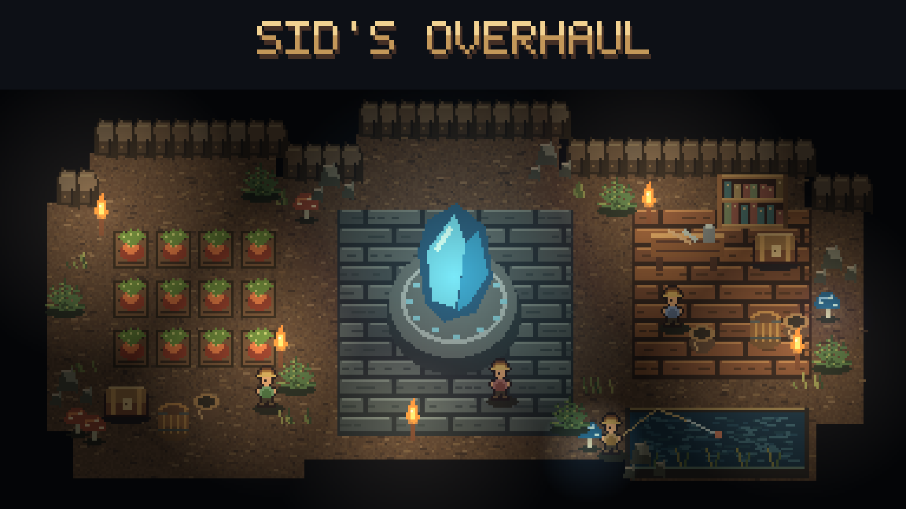

# Sid's Overhaul

A bunch of my Core Keeper mods in one download. Crops replant after you harvest them, machines run faster, loadouts can share gear, and there's more storage, more merchants, and a lot of settings to play with.

Some of this makes the game easier. Machines default to 5x speed, for example, and you can change things like durability, XP, and enemy difficulty. Have a look through **Settings > Mod Options** and set it up how you like.

## Installing

For **Core Keeper 1.3.0**. Subscribe to [Sid's Overhaul](https://steamcommunity.com/sharedfiles/filedetails/?id=3813043354) and [CoreLib](https://steamcommunity.com/sharedfiles/filedetails/?id=3673516180), then restart the game. Mod Options is already included.

Turn off any separate versions of the included mods so you aren't running the same feature twice. In multiplayer, the host and everyone joining need matching versions of the Overhaul and CoreLib. The host generally controls settings that change the world; you set your own controls and cosmetic options.

If you only want a few of these, you can get them separately from [the collection](https://steamcommunity.com/sharedfiles/filedetails/?id=3814775238). For a manual install, grab the [latest GitHub release](https://github.com/Sthakur27/corekeeper-mods/releases/latest) and follow the instructions in the zip.

## What's in it

- **Gear and loadouts:** Share gear between loadouts, give each one its own vanity outfit, and add two extra loadout tabs. Auto Loadout Switch lets you link the item you're holding to a loadout with Ctrl+L. Armor Dye colors your gear, and Pet Editor lets you change pet levels, talents, and colors.
- **Storage:** Runic Storage connects units into one searchable inventory, with upgrades from 40 to 360 slots each. Ender Stash gives your character a personal 40-slot stash that travels with you and survives death. Coin Pouch gives coins their own slot, holding up to 99,999; merchants take payment from it automatically.
- **Farming and fishing:** Auto Replant uses seeds nearby or in your bag after you harvest. Bigger Watering Cans water 2x2 or 4x4 patches, and Faster Mushrooms changes spread and regrowth. Fast Auto Fishing handles the fishing for you with shorter waits (boss bites keep their usual timing). Better Fishing Loot and Golden Chance let you raise the odds of fishing valuables, golden crops, and rarer bonus food.
- **Building and machines:** Build Tools gives you bigger tool areas, a block brush, block swapping, and roof controls. Faster Machines speeds up smelting, cooking, sawing, hatching, and drilling, with separate settings for each. Solarite Drill has 3x the Scarlet Drill's mining damage. Infinite Ore Boulders keeps boulders from running out; Movable Ore Boulders lets you carry them to your drills.
- **Shops and coins:** Fish Seller adds fish and Shiny Larva Meat to buy. Merchant Restock changes how often shops refill and can set a minimum stock per item (also for Fish Seller and More NPCs). Valuable Value makes valuables sell for 10x by default, adjustable from 1x to 100x. Coin Drops gives you coins for enemy kills, including kills by your pets and minions.
- **Combat and progression:** Quick Buff adds keys for buffs (B), food (F), healing (H), and mana (J). Longer Buffs extends buff durations; Durability Multiplier changes wear; Difficulty Tuning adjusts enemies and bosses in Hard and Normal worlds; Skill XP & Talent Points changes XP gains and player and pet talent points. Mushroom Slayer lets strong hits get through gray Shrooman Brute armor, and Boss Bonus Loot adds drops to selected bosses and enemies. Weapon Tweaks makes the Burnzooka's rocket explode on the first enemy it hits. Stats HUD shows FPS, DPS, movement speed, and distance to the Core next to your health bar (F3 to toggle), and F4 hides the buff icons under the health bar.
- **Getting around:** Magic Mirror is a reusable return to the Core. Potion of Return takes you home and leaves a one-use return point you can reach from a waypoint. Vehicle Speed changes boat and go-kart speeds, and Keep Minions On Teleport brings your summons along.
- **Other bits:** Item Spawner (Z) lets the host, admins, and creative-mode characters spawn items, leveled gear, and cooked dishes. Other players can browse; its permission check runs on the player's client and is not enforced by the server. Hit Sound Effects lets you pick combat sounds or use your own audio. The startup logos are skipped too.

There are three **alpha features** in the bundle:

- **Drill Pod:** An end-game hover craft that crosses water, lava, and pits, drills through walls, and lays floor or digs pits. Craft it at the Rift Statue for 300 Pandorium + 100 Solarite Bars. Tested in single player only.
- **Enchanting:** Pay Gold Bars and Ancient Coins at an Enchanting Table for random enchantments, up to three per item. Craft the table at a Galaxite Workbench. The table and parts of the system have been tested in single player, but several effects are still untested in combat and multiplayer is untested.
- **More NPCs:** Eight new merchants. Beat each boss, then put its dropped idol in a room with a free bed. Tilly also stocks Farmer's Hat (500 coins), Eostre Necklace (1,500) and Petal Ring (1,000), one each per restock at 1x; scroll past her first 24 items with the mouse wheel. They sell things like building supplies, potions, eggs, farm animals, seeds, and summoning items for bosses you've beaten. This takes the place of Potion Seller in the bundle and clears its added stock from the vanilla shops. It loads in game, but merchant arrival, trading, animations, and multiplayer still need playtesting. Old Hemlock's and Tridra's full shops need mouse-wheel scrolling; controllers can only reach the first 24 items.

Alpha features may change. Back up your saves before trying them.

Each mod's folder on [GitHub](https://github.com/Sthakur27/corekeeper-mods) has its full controls, settings, and limitations.

## Changing settings

Open **Settings > Mod Options** to find each feature's settings. Use the arrows to change a value. Resetting one of these pages to defaults takes a second click to confirm.

The **Turn Sub-Mods On/Off** page lets you turn whole features off after a restart. Vanity Slots & Shared Equipment, Five Loadouts, Ender Stash, Coin Pouch, and Runic Storage stay on because they add slots that may be holding your items.

**Empty the stash, coin pouch, storage, and extra equipment slots before uninstalling the Overhaul.** Back up your saves first: loading and saving without the bundle can remove its custom items and placed objects. Remove Magic Mirrors before uninstalling too.

Turning Enchanting off or removing it can leave the last active bonuses on your character; uninstalling does not reliably clear them.

Mod Options can also show settings from some other CoreLib mods. If a page hasn't appeared yet, try reopening the menu. It won't show every mod or every kind of setting, and some changes need a restart. Those extra pages don't have a reset-all button. See [Mod Options](https://github.com/Sthakur27/corekeeper-mods/tree/main/ModOptions) for details.

## Latest update

**1.16.14:** Boss Bonus Loot 1.11.0: Infected Cavelings drop the Tome of the Dead 5% of the time (vanilla 0.43%), as part of their normal loot roll.

Older updates are in the [release history](https://github.com/Sthakur27/corekeeper-mods/blob/main/Overhaul/CHANGELOG.md).

## Credits and license

Fast Auto Fishing is a fork of mikufish (GPL-3.0-or-later). The combined Overhaul is distributed under **GPL-3.0-or-later**. Pet Editor is included; Master Pet Plus is not.

Cover artwork generated with AI; not an in-game screenshot.
