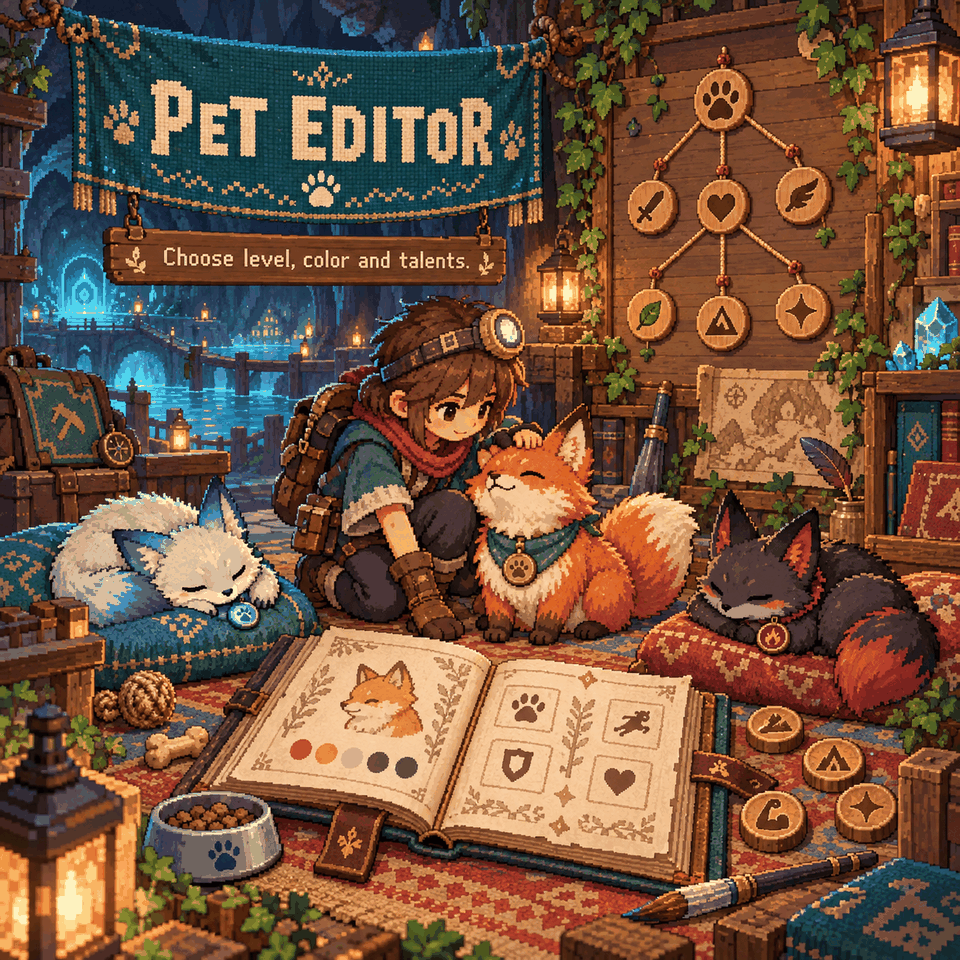

# Pet Editor

Choose your equipped pet’s level, color and talents directly in its familiar talent window.

## How to use

Equip a pet, then open its talent window.

- **Change level:** use the minus and plus buttons under the reset button.
- **Change color:** use the left and right buttons to cycle through that pet's available colors.
- **Replace a talent:** right-click a talent slot, then left-click a talent in the selection grid. Hover to read its description; right-click to close the grid.
- **Refund a talent:** Shift + left-click a filled talent slot to clear its spent points for free.

Spending points still works as usual. The total follows the game's own point formula, including changes from mods such as AllSkills. Lowering a pet's level resets allocated points if the pet would otherwise have too many.

## Chat alternatives

- `/pet level <1-10>`
- `/pet talent <slot 1-9> <talent name or id>`
- `/pet color <n>`
- `/pet unpoint <slot 1-9>`

Commands and buttons edit your own equipped pet. No separate Mod Options page is needed.

## Requirements

Requires **CoreLib** on the host/server and every client. No Mod Options dependency. Changes affect the pet itself and are saved with it.

Written from scratch against Core Keeper's own pet systems; not based on another pet mod. Also included in **Sid's Overhaul**; use one version of this feature.
