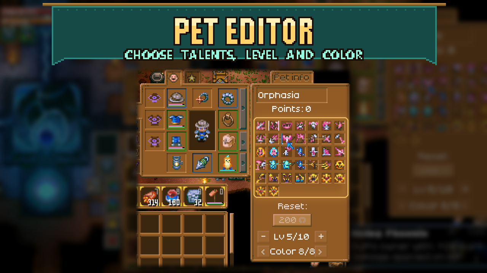

# Pet Editor

Change your equipped pet's level, color and talents from its talent window. You can choose talents yourself and refund spent points for free.

## Using the editor

Equip a pet and open its talent window.

- Use the minus and plus buttons under the reset button to change its level, from 1 to 10.
- Use the left and right color buttons to cycle through that pet's available colors.
- Right-click a talent slot to open the selection grid, then left-click the talent you want. Hover over a talent to read its description. Right-click to close the grid.
- Shift + left-click a filled talent slot to refund all points spent in that slot.

Spend talent points as usual. The total follows the game's point formula, including the pet talent points setting in Skill XP & Talent Points. If lowering the pet's level leaves it with too many points spent, all allocated points are reset so you can spend them again.

There is no separate settings page. Edits affect your own equipped pet and are saved with it.

## Chat commands

You can also make the same edits through chat:

- `/pet level <1-10>`
- `/pet talent <slot 1-9> <talent name or id>`
- `/pet color <n>`
- `/pet unpoint <slot 1-9>`

## Requirements and multiplayer

For Core Keeper 1.3.0. Install Pet Editor and **CoreLib** on the host/server and every client. Mod Options is not required. Each player edits their own equipped pet; the server applies the changes.

Pet Editor is also included in **Sid's Overhaul**. Use the standalone mod or the bundled version of this feature.

Written from scratch against Core Keeper's own pet systems.

Cover is an in-game screenshot of the pet panel; title banner and highlight added.
