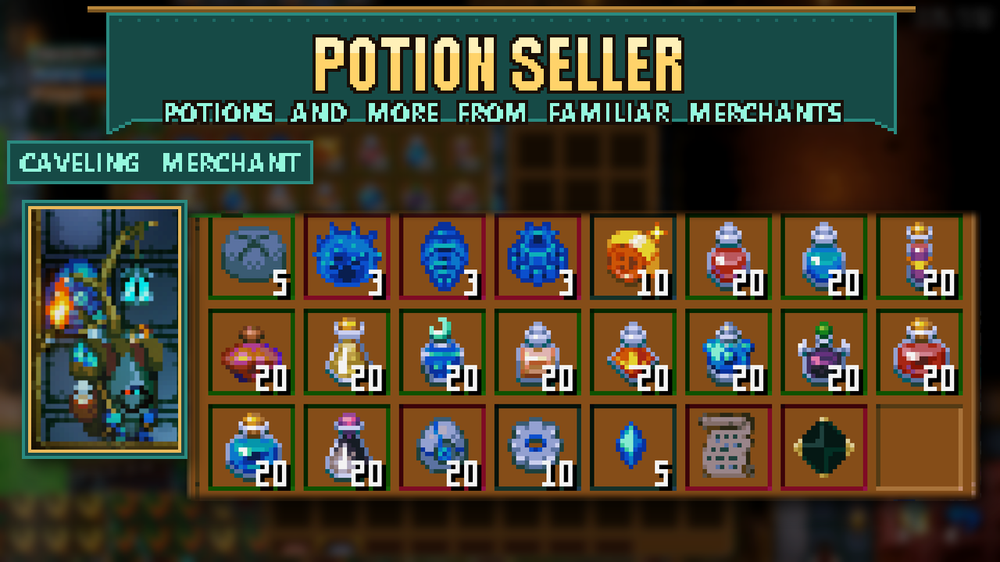

# Potion Seller

Potion Seller lets you spend Ancient Coins on potions, explosives and Titan summoning items at the merchants you already visit. Their normal wares stay available too.

## Where to buy things

- **Caveling Merchant:** 13 potions for 50–500 coins each, plus the Recall Idol for 500 coins. If you have Potion of Return installed, it costs 2,500 coins here. By default, the merchant stocks 20 of each.
- **Slime Merchant:** 15 grenades and bombs for 10–100 coins each, with 20 of each per restock.
- **Fishing Merchant:** Azeos, Omoroth and Ra-Akar summoning items for 2,000 coins each, with 3 of each per restock.

Those are the prices at the default **1x** setting. Potions and explosives don't need an extra boss unlock. Each Titan summon becomes available once that Titan has been defeated in your world, or a connected player has its soul.

The buy window expands to fit the extra items. Fish Seller can expand it further and add scrolling for longer lists. Mods that change the same merchants or item prices may overlap.

## Changing prices and stock

Open **Settings > Mod Options > Potion Seller**.

**Potion price multiplier** changes the buy price of everything this mod adds, including explosives and Titan summons. It defaults to **1x**, with choices from **0.25x to 4x**, and prices change while you play.

**Potions per restock** defaults to **20** and can be set from **1 to 99**. It also covers explosives and the Recall Idol. Your new amount takes effect at the next restock; Titan summons always restock to 3 each.

Selling works differently: every added item sells for one fifth of its base 1x buy price, regardless of your price multiplier. These sell prices replace the game's usual values for those items.

## Requirements and multiplayer

Install **CoreLib**, **Mod Options** and Potion Seller on the host/server and every client. Match your price settings in multiplayer: the server decides what you pay, but a client with a different setting can show the wrong price.

Potion Seller is a separate mod. Sid's Overhaul uses More NPCs instead.
