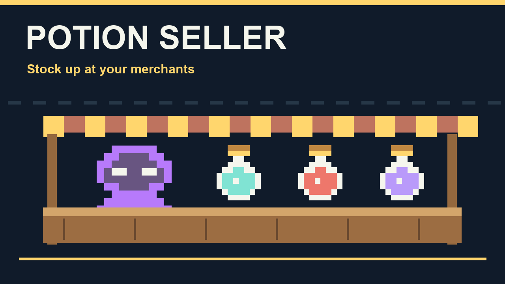

# Potion Seller

Spend Ancient Coins to restock potions, explosives and unlocked Titan summoning items from familiar merchants.

## Where to shop

| Merchant | Added stock | Default price and quantity |
|---|---|---|
| Caveling Merchant | 13 potions and the Recall Idol | Potions: 50–500 coins; Recall Idol: 200. 20 of each per restock. |
| Slime Merchant | 15 grenades and bombs | 10–100 coins. 20 of each per restock. |
| Fishing Merchant | Azeos, Omoroth and Ra-Akar summoning items | 2,000 coins each. 3 of each per restock. |

Potions and explosives are available without an extra boss unlock, alongside the merchant's normal wares. Each Titan summon unlocks once that Titan has been defeated in the world **or** a connected player holds its soul.

## Settings

Open **Settings > Mod Options > Potion Seller**.

- **Potion price multiplier:** default **1x**, with choices from 0.25x to 4x. Despite the label, this scales the buy price of all items added by this mod. Prices update while you play.
- **Potions per restock:** default **20**, adjustable from 1–99. This also applies to explosives and the Recall Idol. Changes appear on the next restock; Titan summons stay at 3 each.

## Before you buy or sell

Added items have fixed sell prices equal to one fifth of their base 1x buy price. Changing the price multiplier changes buying prices only. These fixed sell prices replace the game's usual values for these items.

The buy window grows to make room for the added stock. Fish Seller can extend it further and provide scrolling for longer merchant lists. Other mods that change the same merchants or prices may overlap.

## Requirements

Requires **CoreLib** and **Mod Options** on the host/server and every client. Keep multiplayer price settings matched: the server charges its configured price, while a different client setting can display a different label.

Also included in **Sid's Overhaul**; use one version of this feature.
