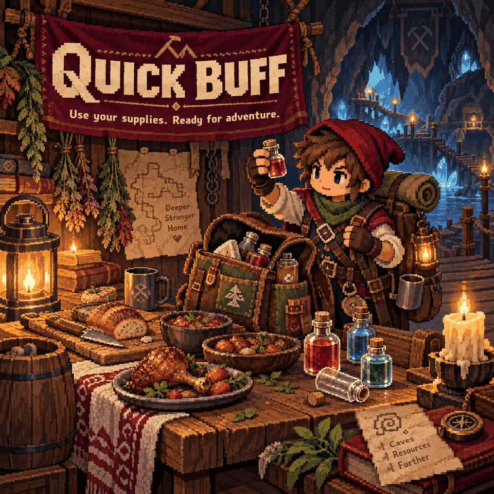

# Quick Buff

Press **B** to use your buff food and potions before a fight. If you've got several items that give the same buff, it picks the strongest one. There are separate keys for healing, mana, and food too.

## How to use it

Keep your supplies in your main inventory or equipped pouches (extra pouch slots count too), then press:

- **B** to use buff food and potions.
- **H** to drink the first instant-healing potion it finds. It checks your hotbar first and does nothing if you're already at full health.
- **J** to drink the first mana potion it finds. Same idea: hotbar first, and nothing used at full mana.
- **F** to use food buffs without drinking potions. By default it only eats cooked food, even if you're not hungry.

You can change the keys under **Controls > Quick Buff**. They won't fire while you have a menu, inventory, or text box open. Check chat to see what was used.

## What it uses

By default, Quick Buff leaves an item alone if all its buffs have more than **30 seconds** left. Once a buff is missing or running low, it can use that item again.

Buffs of the same type don't add together, so it also checks whether you're carrying something stronger. For example, if Crystal Water gives more crit chance than your food, it'll use the Crystal Water for that buff. A stronger buff replaces a weaker one straight away; an equal or weaker one waits until the current buff is running low. The remaining time on a replaced buff is lost.

Bonuses from your gear don't count as active buffs, so they won't stop you from using a potion. Eating and drinking by hand still works as usual.

B won't use items that only fill hunger, heal, restore mana, or give permanent upgrades. Use H and J for healing and mana potions.

## Settings

Under **Settings > Mod Options > Quick Buff**, you can change:

- **Skip buffs that are still active:** on by default.
- **Still active means more than (seconds):** 30 seconds by default, from 0 to 300.
- **Quick Food: only cooked food:** on by default.
- **Quick Food: skip fish dishes:** off by default.

The food settings only affect F. B still checks all food that gives buffs.

## Installing

You'll need **CoreLib** and **Mod Options**. In multiplayer, the host/server and everyone joining need them and Quick Buff installed. Each player can use an action once every **0.4 seconds**. The server handles using the items, so you may notice a little extra delay online. Dedicated headless servers haven't been tested.

Quick Buff is also in **Sid's Overhaul**, so you don't need both versions.

If you'd rather use chat commands, there's `/quickbuff` (`/qb`), `/quickheal` (`/qh`), `/quickmana` (`/qm`), and `/quickfood` (`/qf`).

Cover artwork generated with AI; not an in-game screenshot.
