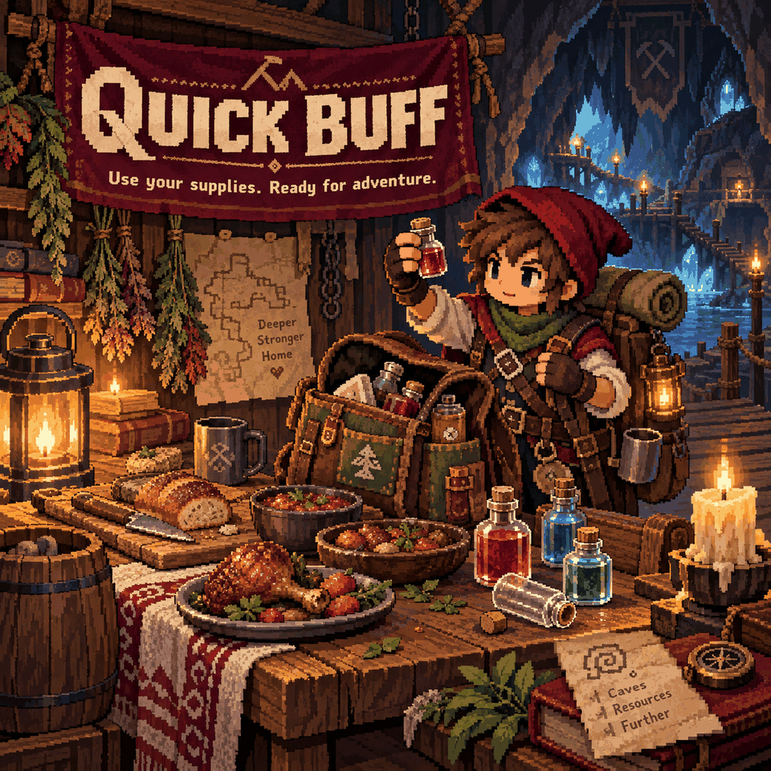

# Quick Buff

Get ready for a fight with one key, then heal or refresh your food buffs just as quickly.

## Keys at a glance

- **B — Quick Buff:** consume one of each distinct buff food and buff potion you carry.
- **H — Quick Heal:** drink the first instant-healing potion found, starting with the hotbar. Does nothing at full health.
- **F — Quick Food:** consume buff foods only. By default, this uses cooked food and leaves raw food alone. It works regardless of hunger.

Rebind these in **Controls > Quick Buff**. The actions search your main inventory and equipped pouches, including extra pouch slots. Keys are ignored while menus, inventories or text entry are open. A chat message reports the result.

## Avoid using supplies too early

By default, an item is skipped when **all** of its buffs have more than **30 seconds** left. If even one buff is missing or running low, the item can be used again. Quick Buff leaves hunger-only, heal-only and permanent-upgrade items alone; use Quick Heal for healing potions.

Open **Settings > Mod Options > Quick Buff** to change:

- **Skip buffs that are still active:** on by default.
- **Still active means more than:** 30 seconds, adjustable from 0–300.
- **Quick Food: only cooked food:** on by default.
- **Quick Food: skip fish dishes:** off by default.

The last two settings affect F only. B still considers all qualifying buff foods.

## Chat commands

Use `/quickbuff` (`/qb`), `/quickheal` (`/qh`) or `/quickfood` (`/qf`) as alternatives to the keys.

## Requirements and limits

Requires **CoreLib** and **Mod Options** on the host/server and every client. Supplies are consumed on the server; multiplayer results may appear after a short network delay. Each action is limited to one request per 0.4 seconds per player. Dedicated headless server behavior has not been verified.

Also included in **Sid's Overhaul**; use one version of this feature.
