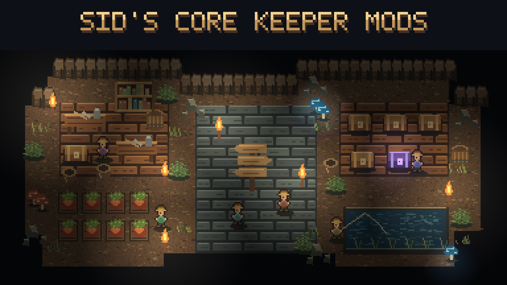

# Sid's Core Keeper mods

These are my Core Keeper mods. Some take care of things like replanting crops or switching gear; others add items, merchants, or settings for how hard you want the game to be. Pick the ones you want below.

Looking up a drop rate, merchant, recipe, or control? The [mod wiki](https://docs.google.com/document/d/1dp9O_5eAnKm_d1RYUdeyESk8o58MceBOP7w9vl0kneg/edit) has searchable reference tables and guides, organized into tabs. It follows the current source, so some entries may be newer than the published release.

## Choose how to install

- **One package:** [Sid's Overhaul on Steam Workshop](https://steamcommunity.com/sharedfiles/filedetails/?id=3813043354). Bundles most of these mods, with Mod Options built in. Check its page for the full list. Subscribe to CoreLib too.
- **Pick individual mods:** [Sid's Core Keeper Mods collection](https://steamcommunity.com/sharedfiles/filedetails/?id=3814775238). Choose the mods you want and subscribe to their required items.
- **Manual download:** [Latest GitHub release](https://github.com/Sthakur27/corekeeper-mods/releases/latest). Follow the release's install steps and the zip's README.txt. The published release may be older than the source in this repository.

Use the Overhaul or the individual versions of its features. Installing both runs the same features twice. Restart Core Keeper after installing or updating mods. For multiplayer, check each mod's requirements and use matching versions on the host and clients.

## Find a mod

### Inventory and appearance

| Mod | What it helps with |
|---|---|
| [Vanity Slots & Shared Equipment](LoadoutSharing/README.md) | Empty equipment and vanity slots borrow from earlier loadouts (formerly Loadout Fallback). |
| [Five Loadouts](FiveLoadouts/README.md) | Add two more equipment loadouts, with optional direct keys. Requires CoreLib, Mod Options, and Vanity Slots & Shared Equipment. |
| [Runic Storage](ConnectedStorage/README.md) | Search connected storage from one inventory and upgrade units from 40 to 360 slots each. |
| [Ender Stash](EnderStash/README.md) | Access your character's personal 40-slot stash through an Ender Chest. |
| [Coin Pouch](CoinPouch/README.md) | Picked-up Ancient Coins go into their own slot under the vanity pants, up to 99,999; merchants take payment from it. |
| [Potion of Return](WormholePotion/README.md) | A one-use recall to the Core that marks your spot on the map; teleport back to it once from any waypoint. 25 Gold Bars at an Ancient Hologram Pod. |
| [Drill Pod (Alpha)](DrillUnit/README.md) | End-game hover craft from the Rift Statue: crosses water, lava and pits, drills through walls, lays floor or digs pits around you. Alpha, single player tested. |
| [Enchanting (Alpha)](Enchanting/README.md) | Random enchantments for weapons, tools and armor from an Enchanting Table, paid with Gold Bars and Ancient Coins; up to three per item. Alpha, single player tested. |
| [Coin Drops](CoinDrops/README.md) | Enemies you kill (yourself or your pets, minions, arrows and bombs) drop Ancient Coins, scaled by their max health; bosses drop a big pile. |
| [Auto Loadout Switch](AutoLoadouts/README.md) | Link an item to a loadout with Ctrl+L, and the game switches to that loadout whenever you start holding it. |
| [More NPCs (Alpha)](BossMerchants/README.md) | Eight new merchants, one per boss: place the idol a boss drops in a room with a free bed and its merchant moves in, selling blocks, decor, explosives, potions, pet eggs, hydra goods, farm animals and seeds. |
| [Armor Dye](ArmorDye/README.md) | Color individual armor pieces, weapons and tools. |
| [Pet Editor](PetEditor/README.md) | Change a pet's level, talents and color. |
| [Item Spawner](ItemSpawner/README.md) | Search and spawn items, leveled gear, and cooked dishes. For the host and admins; requires CoreLib and Runic Storage. |

### Farming, fishing and supplies

| Mod | What it helps with |
|---|---|
| [Auto Replant](AutoReplant/README.md) | Replant harvested crops using matching seeds nearby or in your bag. |
| [Bigger Watering Cans](BiggerWateringCans/README.md) | Water larger patches of soil at once. |
| [Faster Mushrooms](FasterMushrooms/README.md) | Adjust spread and mushroom regrowth near players. |
| [Fast Auto Fishing](FastAutoFishing/README.md) | Automate fishing and shorten the wait between catches. |
| [Better Fishing Loot](BetterFishingLoot/README.md) | Adjust the odds of fishing up valuable non-fish loot. |
| [Potion Seller](PotionSeller/README.md) | Buy potions, explosives and Titan summon items from merchants. |
| [Fish Seller](FishSeller/README.md) | Buy fish and Shiny Larva Meat; scroll through expanded shops. |
| [Merchant Restock](MerchantRestock/README.md) | Choose how quickly merchants refill their stock. |
| [Infinite Ore Boulders](InfiniteOreBoulders/README.md) | Keep drilling ore boulders without using them up. |
| [Movable Ore Boulders](BoulderMover/README.md) | Mine an ore boulder loose and carry it to your drills. |
| [Build Tools](BuildTools/README.md) | Bigger tool areas remembered per tool, a block brush with floor/wall modes and Swap, and roofing gadget modes. |
| [Faster Machines](FasterMachines/README.md) | Set the speed of each machine: furnaces, kilns, cooking pot, table saw, egg incubator and drills. |
| [Solarite Drill](SolariteDrill/README.md) | A gold drill one tier above the Scarlet Drill, crafted at the Solarite Workbench, with 3x its mining damage. |

### Combat, travel and progression

| Mod | What it helps with |
|---|---|
| [Quick Buff](QuickBuff/README.md) | Use shortcuts for buff food, potions, healing and mana. |
| [Longer Buffs](BuffDurationFloor/README.md) | Set a minimum duration for short food and potion buffs. |
| [Durability Multiplier](DurabilityMultiplier/README.md) | Choose how quickly equipment wears out. |
| [Difficulty Tuning](DifficultyTuning/README.md) | Tune enemies and bosses separately for Normal and Hard worlds. |
| [Mushroom Slayer](MushroomSlayer/README.md) | Let strong hits get through gray Shrooman Brute armor. The red phase stays the same; see the mod page for testing limits. |
| [Boss Bonus Loot](BossBonusLoot/README.md) | Add extra rewards to selected bosses and enemies. |
| [Skill XP & Talent Points](SkillXPMultiplier/README.md) | Adjust experience gains per skill and the talent points each skill gives. |
| [Magic Mirror](MagicMirror/README.md) | Return to the Core without consuming the item. Craft for 50 Solarite Bars + 10 Recall Idols, or a 20% Omoroth drop. |
| [Keep Minions On Teleport](KeepMinions/README.md) | Bring summoned minions along when you teleport. |
| [Vehicle Speed](VehicleSpeed/README.md) | Change boat and go-kart speeds. |
| [Hit Sound Effects](StimHits/README.md) | Choose sounds for hits, kills and damage taken. |
| [Golden Chance](GoldenChance/README.md) | Raise your chances of golden crops and rarer bonus food. Regular main dishes stay the same. |

### Settings and the full package

- [Mod Options](ModOptions/README.md) puts supported mod settings in one in-game menu. Some other CoreLib mods show up there too, though it can't show every mod or setting. Individual mod pages list their required dependencies.
- [Sid's Overhaul](Overhaul/README.md) bundles most of these mods, with Mod Options built in. Its page lists what's included.

## Worlds and characters

[World & Character Manager](SlotOrganizer/README.md) adds buttons to reorder, copy, and edit your saves from the main menu. It is a separate install, even if you use the Overhaul.

## Source, credits and artwork

Each folder contains its mod's source and documentation. Credits and license details are kept on the individual pages; Fast Auto Fishing is a mikufish fork, and the Overhaul uses GPL-3.0-or-later. Listing artwork lives in `release/`; older artwork scripts are retained there too.

`release/build_overhaul.py` assembles the combined package.
